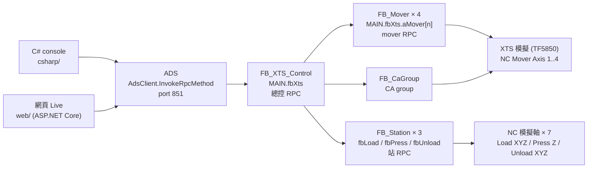
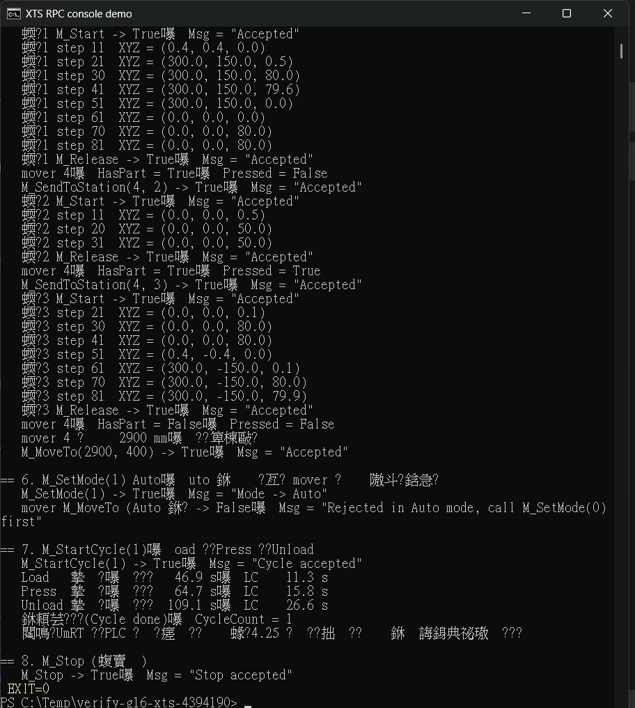
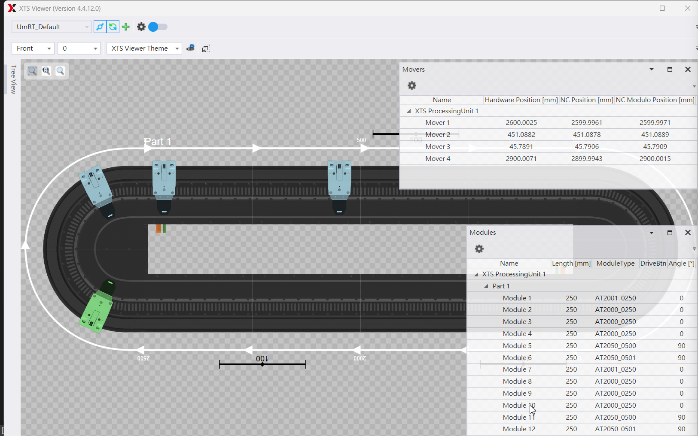
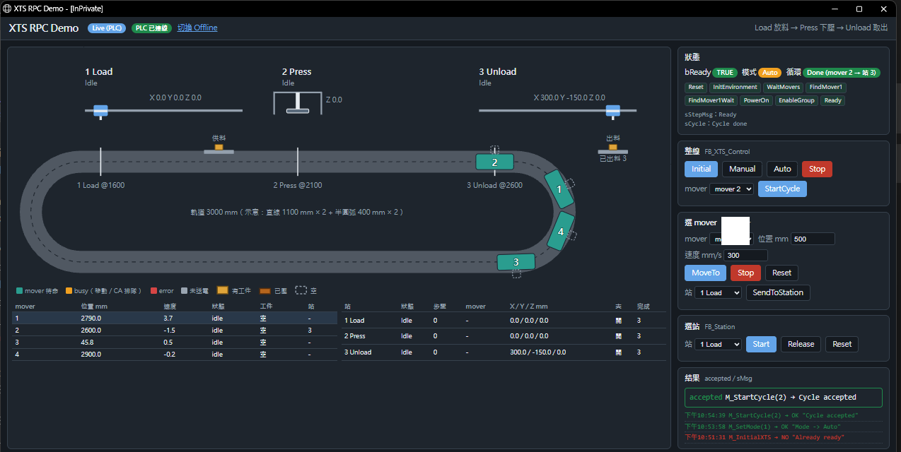
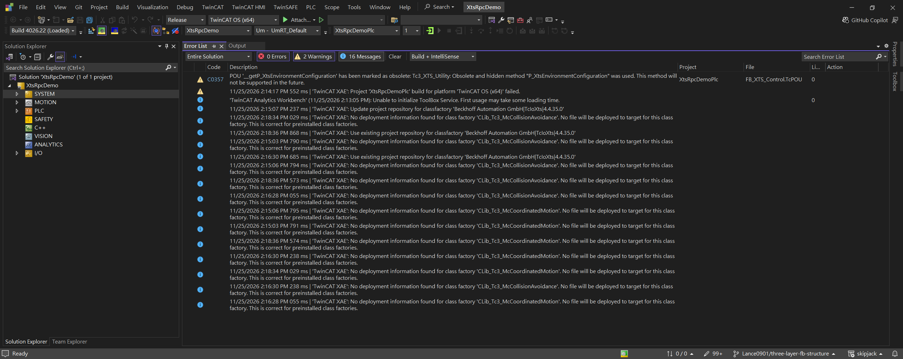

# XTS RPC Demo：C# 用 `TcRpcEnable` method 控制模擬 XTS

在 TwinCAT 3 User Mode Runtime (UmRT) 上跑 XTS 模擬（4 個 mover、3 站：Load / Press / Unload），C# console 與網頁透過 ADS 的 `InvokeRpcMethod` 呼叫 PLC 上加了 `{attribute 'TcRpcEnable'}` 的 method：初始化 XTS、移動單一 mover、手動操作單站、跑一輪自動循環。

> **狀態**：PLC Build 0 error，已在 UmRT 上 Activate + Run，C# console 8 段示範與網頁 Live 模式都跑完一輪，結果見[驗證結果](#驗證結果)。

## 目錄

1. [這是什麼](#這是什麼)
2. [需求環境](#需求環境)
3. [專案結構](#專案結構)
4. [PLC 端設計](#plc-端設計)
5. [快速開始](#快速開始)
6. [C# 端重點](#c-端重點)
7. [網頁模擬器](#網頁模擬器web)
8. [驗證結果](#驗證結果)
9. [疑難排解](#疑難排解)
10. [注意事項與沒測的項目](#注意事項與沒測的項目)
11. [參考資料](#參考資料beckhoff-infosys)
12. [License](#license)

## 這是什麼

上位機（MES、測試程式、網頁）要對 PLC 下「帶參數、要立即回覆能不能做」的命令，例如「mover 2 移到 1500 mm，速度 300」。用寫變數也做得到，但要自己處理「寫參數 → 寫觸發 → 讀回結果」三步的時序；RPC method 一次呼叫就帶參數，立刻拿到 `BOOL`（收下與否）與拒絕原因 `sMsg`。

本專案示範三件事：

1. **參數檢查與拒絕原因在 PLC 端做**：C# 不用知道軌道長度、速度上限、站狀態。
2. **Method 只收命令，動作在 cyclic 程式裡做**（原因見[為什麼 method 只設旗標](#為什麼-method-只設旗標)）。
3. **三層 FB（總控 / mover / 站）各有自己的 RPC method**，加上「ready 閘門 + 模式鎖」統一管控誰能下命令。

### 架構



文字版（同一件事，含每層用到的 MC FB）：

```
 C# console (csharp/)    網頁 Live (web/)
        └──────┬──────────────┘
               │  AdsClient.InvokeRpcMethod(symbolPath, methodName, args, out outputs)
               ▼
 ADS ──► PLC port 851
          MAIN.fbXts : FB_XTS_Control ─────────────── 總控 RPC
            │  每 cycle 寫 stPermit (bReady, eMode) 給子 FB
            ├─ aMover[1..4] : FB_Mover ────────────── mover RPC ── MC_Power / MC_MoveAbsoluteCA / MC_HaltCA ── NC Mover Axis 1..4 ── XTS (TF5850 模擬)
            ├─ fbGroup : FB_CaGroup ──────────────────────────────── CA group (XtsCaGroup)
            ├─ fbLoad   : FB_StationLoad   ─┐                         XYZ：NC Load X / Y / Z     (模擬軸)
            ├─ fbPress  : FB_StationPress  ─┼─ 站 RPC (繼承自 FB_Station)  Z：NC Press Z          (模擬軸)
            └─ fbUnload : FB_StationUnload ─┘                         XYZ：NC Unload X / Y / Z   (模擬軸)
```

## 需求環境

| 項目 | 內容 |
|---|---|
| TwinCAT | TwinCAT 3.1 Build 4026（XAE + UmRT）；驗證時用 XAE 4026.22 |
| 授權 | **TF5850** TC3 XTS Extension（XTS 驅動、XTS Viewer）、**TF5400** TC3 Advanced Motion Pack（CA group / `MC_MoveAbsoluteCA`，Activate XTS 專案時要）。用 trial 授權即可 |
| PLC library | `Tc3_XTS_Utility`、`Tc3_McCollisionAvoidance`、`Tc3_McCoordinatedMotion`、`Tc3_Module`（plcproj 已引用，隨 TF5850 / TF5400 安裝） |
| Runtime | UmRT（User Mode Runtime）；不需要實體 XTS，軌道與 mover 都是模擬 |
| .NET | .NET 8 SDK；NuGet `Beckhoff.TwinCAT.Ads` 7.0.389（`dotnet run` 時自動還原） |
| 網頁 | Live 模式要 .NET 8；Offline 模式只要瀏覽器 |
| 選用 | XTS Viewer（看 mover 實際位置） |

## 專案結構

```
plc/
  XtsRpcDemo.sln
  XtsRpcDemo/XtsRpcDemo.tsproj           XTS 模擬設定 (1 XPU、12 module 3000 mm、4 mover、CA group) + 7 支 NC 模擬軸
  XtsRpcDemo/XtsRpcDemoPlc/
    POUs/MAIN                            呼叫 fbXts；REFERENCE 備案路徑 refMover1..4
    POUs/FB_XTS_Control                  總控 (RPC)：初始化、模式、ready 閘門、自動循環、站佔用
    POUs/FB_Mover                        單一 mover (RPC)：MC_Power / MC_MoveAbsoluteCA / MC_HaltCA、工件狀態
    POUs/FB_Station                      站底層 (RPC)：站狀態機 Idle / Busy / Done / Error
    POUs/FB_StationGantry                XYZ 取放站共用 (EXTENDS FB_Station)
    POUs/FB_StationLoad / FB_StationUnload   EXTENDS FB_StationGantry，只差取放點與工件檢查
    POUs/FB_StationPress                 EXTENDS FB_Station，下壓 → 保壓 → 上升
    POUs/FB_SimAxis                      單支 NC 模擬軸包裝 (MC_Power / MC_MoveAbsolute / MC_Halt)
    POUs/FB_CaGroup                      CA group：加軸、enable、disable
    POUs/F_CheckCmdAllowed               ready 閘門 + 模式鎖，所有命令 method 共用
    POUs/F_RingPosition / F_InitStepName 環上位置換算、初始化步驟名稱
    DUTs/                                E_InitStep、E_XtsMode、E_CycleState、E_StationState、E_MoveState、
                                         ST_CmdPermit、ST_LineStatus、ST_MoverStatus、ST_StationStatus
    GVLs/GVL_Param                       常數：軌道長、站位置、速度、逾時
    GVLs/GVL_ErrorId                     錯誤碼 16#E001..16#E401
csharp/                                  .NET 8 console (XtsRpcClient)
  Program.cs                             8 段示範流程
  XtsRpc.cs                              RPC client：InvokeRpcMethod 包裝、命令重試、ST_LineStatus 解析 (console 與 web 共用)
  Options.cs                             命令列參數 (console 與 web 共用)
web/                                     網頁模擬器：ASP.NET Core minimal API (.NET 8) + 純靜態前端
  XtsWeb.csproj Program.cs PlcService.cs   API endpoint、ADS 連線、狀態輪詢 + SSE；以 <Compile Include> 連結 csharp/XtsRpc.cs、Options.cs
  wwwroot/index.html css/ js/              SVG 畫面；sim.js = Offline 模擬器，live.js = Live 後端，app.js = 畫面與按鈕
docs/images/                             截圖 (PLC Build、UmRT runtime、網頁 Offline)
```

XTS 設定來自另一個已在 UmRT 上跑過 CA 繞線的示範專案，從 6 mover 刪成 4 mover（刪掉 Mover 5/6 的 TcCOM 物件、NC 軸與 mapping），XPU 的 `IdDetectionMode` 從 `Standard` 改成 `Mover1`（讓 Find mover 1 真的執行），其他參數不動：模擬模式、軌道 3000 mm、mover 啟動位置 `UseOffsetAndDistance`（offset 40 mm、間距 400 mm、±10 mm 隨機）。

## PLC 端設計

### 三層 FB 的職責

| FB | C# 路徑 | 職責 |
|---|---|---|
| `FB_XTS_Control` | `MAIN.fbXts` | 初始化狀態機（`M_InitialXTS`）、Manual / Auto 模式、算出 `stPermit` 每 cycle 傳給子 FB、自動循環狀態機、站佔用檢查（`M_SendToStation`）、ready 後監控掉出可控 |
| `FB_Mover` | `MAIN.fbXts.aMover[n]` | 一台 mover：`MC_Power`、`MC_MoveAbsoluteCA`、`MC_HaltCA`、`MC_Reset`；參數範圍檢查；工件狀態 `bHasPart` / `bPressed` |
| `FB_Station`（`FB_StationLoad` / `FB_StationPress` / `FB_StationUnload`） | `MAIN.fbXts.fbLoad` / `fbPress` / `fbUnload` | 站狀態機；子類別覆寫 `M_CheckStart`（工件條件）與 `M_Sequence`（動作步驟） |

### RPC method 一覽

所有命令 method 回 `BOOL`（TRUE = 已接受，**不是已完成**），最後一個輸出 `sMsg : STRING` 是拒絕原因或 `'Accepted'`。進度用狀態 method 輪詢。

**總控 `FB_XTS_Control`（`MAIN.fbXts`）**

| Method | 輸入 | 輸出 | 條件 |
|---|---|---|---|
| `M_InitialXTS` | – | `sMsg` | 不在初始化中、沒在自動循環、尚未 ready |
| `M_ReadXTS_Status` | – | 見[下表](#m_readxts_status-輸出欄位) | 隨時可讀 |
| `M_GetStatus` | – | `stLine : ST_LineStatus, sCycle : STRING` | 隨時可讀；整線快照（4 mover、3 站、XYZ / 下壓軸位置、循環） |
| `M_SetMode` | `nMode : INT`（0 Manual / 1 Auto） | `sMsg` | 自動循環中拒絕；不受 ready 限制 |
| `M_StartCycle` | `nMover : UINT` | `sMsg` | ready + **Auto**、三站 Idle、mover 沒工件、路徑上沒有別的 mover |
| `M_Stop` | – | `sMsg` | **永遠接受**（不受 ready / 模式限制） |
| `M_MoveTo` | `nMover : UINT, fPosition : LREAL, fVelocity : LREAL` | `sMsg` | ready + Manual；mover 路徑的備案 |
| `M_SendToStation` | `nMover : UINT, nStation : UINT` | `sMsg` | ready + Manual、站號 1..3、站沒被別的 mover 佔用 |
| `M_StartStation` / `M_ReleaseStation` | `nStation : UINT` | `sMsg` | ready + Manual；站路徑的備案 |

**單一 mover `FB_Mover`（`MAIN.fbXts.aMover[n]`，備案 `MAIN.refMover{n}`）**

| Method | 輸入 | 輸出 | 條件 |
|---|---|---|---|
| `M_MoveTo` | `fPosition : LREAL`（mm，0 ≤ p < 3000）, `fVelocity : LREAL`（mm/s，0 < v ≤ 1500） | `sMsg` | ready + Manual、mover 沒 error、已送電、上一個命令已被 PLC 取走 |
| `M_Stop` | – | `sMsg` | 永遠接受（沒送電時回 `'Not powered, nothing to stop'`，仍回 TRUE） |
| `M_Reset` | – | `sMsg` | ready + Manual |
| `M_GetStatus` | – | `fPosition : LREAL, fVelocity : LREAL, bBusy, bError, nErrorId : UDINT, bHasPart, bPressed, bPowered` | 隨時可讀 |

`M_MoveTo` 只往正方向走：目標 = 目前位置 + 環上差距。

**單站 `FB_Station`（`MAIN.fbXts.fbLoad` / `fbPress` / `fbUnload`）**

| Method | 輸入 | 輸出 | 條件 |
|---|---|---|---|
| `M_Start` | – | `sMsg` | ready + Manual、站 Idle、站上有 mover、工件狀態符合（Load：沒工件；Press：有工件且沒下壓；Unload：有工件） |
| `M_Release` | – | `sMsg` | ready + Manual、站在 Done |
| `M_Reset` | – | `sMsg` | ready + Manual；清站的 Error 回 Idle |
| `M_GetStatus` | – | `nState : INT, nStepNow : INT, bOccupiedNow, nMoverNow : INT, bErrorNow, nErrorIdNow : UDINT, nDone : UDINT, fAxisX, fAxisY, fAxisZ : LREAL` | 隨時可讀 |

站的 RPC method 定義在父類別 `FB_Station`，`fbLoad` / `fbPress` / `fbUnload` 是子類別 instance，C# 直接對子類別路徑呼叫（繼承來的 method，UmRT 上實測可用）。

**為什麼總控又留 `M_MoveTo` / `M_SendToStation` / `M_StartStation` / `M_ReleaseStation`**

1. `M_SendToStation` 要同時看「站有沒有被別的 mover 佔用」，這個資訊只有總控有。
2. **備案路徑**：開發時陣列元素（`aMover[2]`）與繼承 method 能不能直接 `InvokeRpcMethod` 還沒確定，總控層的路徑一定是 `MAIN.fbXts`。UmRT 實測兩種主路徑都可用，備案保留給其他 TwinCAT 版本或改結構時用。

### 命令閘門：`ST_CmdPermit` / `F_CheckCmdAllowed`

| 命令 | 未 ready | ready + Manual | ready + Auto |
|---|---|---|---|
| 讀狀態（`M_GetStatus`、`M_ReadXTS_Status`） | 收 | 收 | 收 |
| `M_Stop`（總控、mover） | **收** | 收 | 收 |
| `M_SetMode` | 收 | 收 | 收（自動循環中拒絕） |
| `M_InitialXTS` | 收 | 拒（已 ready） | 拒（已 ready） |
| mover / 站的直接命令、總控 `M_MoveTo`、`M_SendToStation`、`M_StartStation`、`M_ReleaseStation` | 拒：`XTS not ready, call M_InitialXTS first` | 收 | 拒：`Rejected in Auto mode, call M_SetMode(0) first` |
| `M_StartCycle` | 拒 | 拒：`Needs Auto mode, call M_SetMode(1) first` | 收 |

```iecst
TYPE ST_CmdPermit :
STRUCT
    bReady : BOOL;          // XTS 可控 (M_InitialXTS 完成且沒掉出)
    eMode : E_XtsMode;      // Manual / Auto
END_STRUCT
END_TYPE

FUNCTION F_CheckCmdAllowed : BOOL
VAR_INPUT
    stPermit : ST_CmdPermit;
    bNeedManual : BOOL;     // 直接對 mover / 站的命令
    bNeedAuto : BOOL;       // 整線自動命令
END_VAR
VAR_OUTPUT
    sMsg : STRING;          // 拒絕原因，允許時為空字串
END_VAR

IF NOT stPermit.bReady THEN
    sMsg := 'XTS not ready, call M_InitialXTS first';
ELSIF bNeedManual AND (stPermit.eMode <> E_XtsMode.Manual) THEN
    sMsg := 'Rejected in Auto mode, call M_SetMode(0) first';
ELSIF bNeedAuto AND (stPermit.eMode <> E_XtsMode.Auto) THEN
    sMsg := 'Needs Auto mode, call M_SetMode(1) first';
ELSE
    sMsg := '';
    F_CheckCmdAllowed := TRUE;
END_IF
```

- **為什麼要模式鎖**：自動循環在跑時，如果 C# 同時對同一台 mover 下 `M_MoveTo`，兩個來源會搶同一個 MC FB 的命令，mover 走到哪裡取決於誰最後寫；Auto 時把直接命令擋掉，自動循環就是唯一的命令來源。
- **為什麼要 ready 閘門**：初始化沒完成時 mover 沒送電、沒加進 CA group，下移動命令只會得到 MC 錯誤；先在 PLC 擋掉並回原因，C# 看得懂。
- **Stop 永遠收**：停止是安全動作，不能因為「還沒 ready」或「在 Auto」被擋。沒送電時 Stop 視為 no-op，回 TRUE 並在 `sMsg` 說明。
- **檢查只寫在一個地方**：總控每個 cycle 算出 `stPermit`，在呼叫子 FB 時當 `VAR_INPUT` 傳進去；子 FB 的 method 用自己的 `stPermit` 呼叫同一個函式。選「總控每 cycle 寫給子 FB」而不是「子 FB 拿 REFERENCE 指回總控」：子 FB 不依賴總控的型別，也沒有 reference 在 Online Change 失效的問題。
- **掉出 ready**：Ready 狀態下任何 mover error、mover 失電、CA group 不是 ready、站上軸 error，都會讓 `eInitStep` 進 `Error`（`nErrId = 16#E310`）、`bReady` = FALSE，所有命令再被擋，直到重新 `M_InitialXTS` 成功（`M_InitialXTS` 會先做 MC_Reset / group reset）。

### 為什麼 method 只設旗標

每個命令 method 只做三件事：檢查參數與狀態 → 寫入請求變數（`bReqMove`、`fReqPositionMm` …，旗標最後寫）→ 回 `BOOL` + `sMsg`。真正的 MC 呼叫在 FB body（cyclic）裡。

1. **執行時機**：Beckhoff 的說明是 RPC method「在 PLC 執行之後被呼叫，使用 cycle 剩下的時間」，method 需要的時間超過剩餘時間就會 real-time overrun（[PLC method call 範例](https://infosys.beckhoff.com/content/1033/tc3_adssamples_net/1046349195.html)）。所以 method 不能等、不能跑迴圈等條件成立，要快進快出。
2. **MC FB 要每 cycle 呼叫**：`MC_MoveAbsoluteCA`、`MC_Power` 這類 FB 靠每個 cycle 被呼叫才會推進狀態（Execute 上升沿、Busy / Done）。只在 method 裡呼叫一次，下一個 cycle 就沒人呼叫它了。
3. **併發**：兩個 C#（或 C# + 網頁）可能幾乎同時呼叫同一個 method。method 內先檢查 `bReqMove` 還沒被取走就拒絕（`'Previous command not yet taken by PLC, retry'`），body 每個 cycle 取走一次，命令不會互相覆蓋。C# 端對這種拒絕自動重送，見[命令重試](#previous-command-not-yet-taken-by-plc-的重試)。
4. **同一個命令兩個來源**：自動循環（cyclic 程式內部）與 RPC 都經過同一個內部 method（例如 `FB_Mover.M_RequestMove`），參數檢查只有一份。

PLC 片段（`FB_Mover`）：

```iecst
{attribute 'TcRpcEnable'}
METHOD PUBLIC M_MoveTo : BOOL
VAR_INPUT
    fPosition : LREAL;      // 目標環上位置 (mm), 0 <= p < cTrackLengthMm
    fVelocity : LREAL;      // 速度 (mm/s), 0 < v <= cMaxVelocityMmS
END_VAR
VAR_OUTPUT
    sMsg : STRING;          // 拒絕原因或 'Accepted'
END_VAR

IF NOT F_CheckCmdAllowed(stPermit := stPermit, bNeedManual := TRUE, bNeedAuto := FALSE, sMsg => sMsg) THEN
    M_MoveTo := FALSE;
    RETURN;
END_IF
M_MoveTo := M_RequestMove(fPosition := fPosition, fVelocity := fVelocity, sMsg => sMsg);
```

```iecst
// FB_Mover body：命令只在這裡取走
IF bReqStop THEN
    bReqStop := FALSE;
    bReqMove := FALSE;
    eMoveState := E_MoveState.StartHalt;
ELSIF bReqMove THEN
    bReqMove := FALSE;
    fTargetAbsMm := stAxis.NcToPlc.ActPos + F_RingPosition(...);
    eMoveState := E_MoveState.StartMove;   // 先讓 Execute = FALSE 一個 cycle
END_IF
fbMove(Axis := stAxis, Execute := (eMoveState = E_MoveState.Moving), Position := fTargetAbsMm, ...);
```

### 初始化：`M_InitialXTS`

```
Idle ─M_InitialXTS─► Reset ─► InitEnvironment ─► WaitMovers ─► FindMover1 ─┬─► PowerOn ─► EnableGroup ─► Ready
                    (MC_Reset,  (Tc3_XTS_Utility   (偵測到 4 台   (Mover1 模式:   │  (MC_Power     (加進 CA group
                     斷電 0.5 s) 環境 Init)          且位置有效)    觸發 detection) │   mover+站軸)   並 enable)
                                                                  └─► FindMover1Wait ─┘
任何一步失敗或逾時 (每步 5 分鐘 PLC 時間) ─► Error，sInitMsg = '<步驟>: <原因>'
Ready 後掉出可控 ─► Error，需重新 M_InitialXTS
```

前面三步（Reset、InitEnvironment、WaitMovers）是準備，核心是三步：

| 順序 | 步驟（`E_InitStep`） | 做什麼 |
|---|---|---|
| 1 | `FindMover1` (21) / `FindMover1Wait` (22) | XPU 的 `IdDetectionMode` 是 `Mover1` 時呼叫 `TriggerMoverIdDetection()`，等 `GetIsMoverIdDetectionValid()`（失敗看 `GetHasMoverIdDetectionError()`） |
| 2 | `PowerOn` (30) | 所有 mover 與 7 支站軸 `MC_Power` |
| 3 | `EnableGroup` (40) | mover 加進 CA group 並 enable，完成後 `Ready` (100) |

- **為什麼先 detection 再送電**：XTS 驅動的事件清單（tsproj 內的 TMC 描述）有 `9016 AxisEnabledBeforeMoverIdDetectionError`：「The mover {0} gets an enable command before Mover 1 Detection is processed」。mover 在 detection 完成前被 enable 會報錯，所以順序是 Find mover 1 → MC_Power → CA group enable。
- **Find mover 1 設定**：`plc/XtsRpcDemo/XtsRpcDemo.tsproj` 裡 XTS ProcessingUnit 1 的 `IdDetectionMode = Mover1`。做法照 InfoSys [PLC variant I (trigger via XtsUtility)](https://infosys.beckhoff.com/content/1033/xts_software/10484562315.html)：前置條件是「所有 mover 位置有效」與「XPU 的模式是 Mover1」。模擬模式下 detection 會完成（UmRT 實測 detection valid）。
- **防呆**：XPU 被改回 `Standard` 時不做 detection、直接進 PowerOn，`sInitMsg` 寫 `FindMover1 skipped: XPU IdDetectionMode is not Mover1, PowerOn`。
- 初始化完成前，`M_StartCycle` 與所有 mover / 站命令都被 `F_CheckCmdAllowed` 擋下。

#### `M_ReadXTS_Status` 輸出欄位

| # | 輸出 | 型別 | 說明 |
|---|---|---|---|
| 0 | `bIsReady` | `BOOL` | TRUE 才能下站與 mover 命令 |
| 1 | `eStep` | `E_InitStep` | 初始化目前步驟（值見上表；Idle 0、Reset 5、InitEnvironment 10、WaitMovers 20、Error 900） |
| 2 | `sStepMsg` | `STRING` | 進度或失敗原因 |
| 3 | `bIsError` | `BOOL` | |
| 4 | `nErrId` | `UDINT` | `GVL_ErrorId`：`16#E301` 初始化逾時、`16#E302` 環境 Init 失敗、`16#E303` detection 失敗、`16#E304` CA group 失敗、`16#E310` 掉出可控 |
| 5 | `eModeNow` | `E_XtsMode` | 0 Manual / 1 Auto |
| 6 | `nFindMover1DoneMs` | `UDINT` | Find mover 1 完成的 PLC 時間（ms，從 `M_InitialXTS` 被 body 取走起算；0 = 這次還沒完成） |
| 7 | `bFindMover1Valid` | `BOOL` | TRUE = Mover ID detection valid；FALSE 且時間 > 0 = IdDetectionMode 不是 Mover1、跳過 |
| 8 | `nPowerOnDoneMs` | `UDINT` | PowerOn 完成的 PLC 時間（ms） |
| 9 | `nGroupDoneMs` | `UDINT` | EnableGroup 完成的 PLC 時間（ms） |

6–9 是給「輪詢抓不到的快步驟」留證據：C# 輪詢 500 ms，FindMover1Wait 這類步驟可能整個被跳過看不到。每次 `M_InitialXTS` 被取走時歸零。

### 三站流程

站位置（mover 停止點，環上 mm，`GVL_Param.cStationPosMm`）：**Load 1600、Press 2100、Unload 2600**；軌道長 3000 mm。

| 站 | 動作 | 軸（NC 模擬軸） | mover 工件狀態 |
|---|---|---|---|
| 1 Load（放料） | XYZ 從供料點 (300, 150) 夾工件放到 mover 上方 (0, 0) | Load X / Y / Z | 完成後 `bHasPart` = TRUE |
| 2 Press（下壓） | Z 下到 50 mm → 保壓 1 s → 回 0 | Press Z | 完成後 `bPressed` = TRUE |
| 3 Unload（取出） | XYZ 從 mover 上方 (0, 0) 夾走工件放到出料點 (300, -150) | Unload X / Y / Z | 完成後兩者清掉 |

Load 與 Unload 各有一組 XYZ（共 7 支模擬軸）：一組 XYZ 同時服務相距 1000 mm 的兩站不合實際，改成兩組，共用 `FB_StationGantry`。

**站狀態機（`FB_Station`，`E_StationState`）**

```
Idle(0) ──M_Start / 自動循環──► Busy(10) ──M_Sequence 完成──► Done(20) ──M_Release──► Idle
                                 │  └─ 步驟逾時 2 分鐘 / 軸 error ──► Error(900) ──M_Reset──► Idle
                                 └─ M_Stop ──► 停軸，回 Idle
```

**XYZ 取放步驟（`FB_StationGantry.M_Sequence`）**

```
10 XY 到取料點 (Z 上) → 20 Z 下 (80 mm) → 30 夾 (0.3 s) → 40 Z 上 → 50 XY 到放料點 → 60 Z 下 → 70 放 (0.3 s) → 80 Z 上 → 完成
```

**下壓步驟（`FB_StationPress.M_Sequence`）**

```
10 Z 下到 50 mm → 20 保壓 1 s → 30 Z 回 0 → 完成
```

奇數步（11、21…）才給軸 `Execute = TRUE`，偶數步設目標並讓 `Execute = FALSE`，確保每次移動都有上升沿。

**自動循環（`M_StartCycle(nMover)`，`E_CycleState`）**

```
Idle/Done ─M_StartCycle─► ToStation(Load) ─到站─► InStation(Load) ─Done─► 放行
          ─► ToStation(Press) ─► InStation(Press) ─► ToStation(Unload) ─► InStation(Unload) ─► Done(100)
任何站 Error / 掉出 ready ─► Error(900)；M_Stop ─► Stopped(800)
```

- `aStationDoneMs[1..3]` 記錄每站完成的 PLC 時間（從 `M_StartCycle` 起算，ms），在 `ST_LineStatus` 裡讀得到。
- **CA 與路徑**：mover 都在 CA group，前面有車就排在後面等（`Busy` 一直 TRUE）。`M_StartCycle` 檢查「這台 mover 往前到 Unload + 110 mm 之間沒有其他 mover」，有就拒絕並說是哪一台。

## 快速開始

### 1. PLC：Build → Activate 到 UmRT → Run

1. 用 TwinCAT XAE 開 `plc/XtsRpcDemo.sln`。
2. 工具列 Target 選本機 UmRT（例如 `UmRT_Default`），Platform `TwinCAT OS (x64)`。
3. Build Solution，確認 0 error（1 個 warning 是 `Tc3_XTS_Utility` 的 obsolete 提示，見[注意事項](#注意事項與沒測的項目)）。
4. Activate Configuration（UmRT 會重啟到 Run mode）→ PLC Login → Start。
5. 選用：開 XTS Viewer 連同一個 UmRT，看 mover 位置。

**取得 UmRT 的 AmsNetId**：XAE 的 Choose Target System 對話框（Target 下拉 → Choose Target System）列出每個 target 的 AmsNetId，選 UmRT 那一列，格式像 `x.x.x.x.1.1`。UmRT 的 AmsNetId 跟本機 XAR 的 `AmsNetId.Local` 不同，C# 一定要帶 `--netid`。

### 2. C# console

```
dotnet run --project csharp -- --netid <UmRT 的 AmsNetId>
```

中文變亂碼時先執行 `chcp 65001`（見[疑難排解](#疑難排解)）。

**8 段示範各做什麼**

| 段 | 做什麼 | 預期結果 |
|---|---|---|
| 1 | ready 前對 mover 2 下 `M_MoveTo` | 被拒：`XTS not ready, call M_InitialXTS first`（已 ready 則略過） |
| 2 | `M_InitialXTS`，每 0.5 s 輪詢 `M_ReadXTS_Status` 印出步驟 | 到 Ready，並印初始化各步完成時間（逾時 900 s 牆鐘） |
| 3 | `M_SetMode(0)` Manual；從 `M_GetStatus` 挑一台「前方到 Unload 沒有其他 mover」的 mover | `Mode -> Manual` |
| 4 | 單一 mover（`aMover[n]`）：`M_GetStatus` → 不合法參數兩次（位置 5000、速度 -1）→ `M_MoveTo` 往前 150 mm → 等停 → `M_Stop` | 兩次被拒（範圍錯誤訊息）、一次 Accepted、Stop 永遠 Accepted |
| 5 | 單站：`M_SendToStation` 送到 Load → 站 `M_Start` → 等 Done → `M_Release`，Press、Unload 同樣；最後停到 2900 mm 讓路 | 印出每步 XYZ 與 mover 的 `bHasPart` / `bPressed` 變化 |
| 6 | `M_SetMode(1)` Auto，再對 mover 下 `M_MoveTo` | 被拒：`Rejected in Auto mode, call M_SetMode(0) first` |
| 7 | 挑路徑淨空的 mover `M_StartCycle` 跑一輪 | 每站完成時印牆鐘秒數與 PLC 秒數，`Cycle done` |
| 8 | 總控 `M_Stop` | `Stop accepted` |

**命令列參數**（console 與網頁 Live 共用，`csharp/Options.cs`）

| 參數 | 預設 | 說明 |
|---|---|---|
| `--netid <AmsNetId>` | `AmsNetId.Local` | 目標 AmsNetId；**連 UmRT 必給** |
| `--port <n>` | `851` | PLC ADS port |
| `--control-path <path>` | `MAIN.fbXts` | 總控 instance 路徑 |
| `--mover-path <template>` | `MAIN.fbXts.aMover[{0}]` | mover 路徑，`{0}` 換成 mover 編號；備案 `MAIN.refMover{0}` |
| `--station-path <template>` | `MAIN.fbXts.{0}` | 站路徑，`{0}` 換成 `fbLoad` / `fbPress` / `fbUnload` |
| `--mover-via-control` | 關 | mover 移動改走總控 `M_MoveTo(nMover, ...)` |
| `--station-via-control` | 關 | 站 Start / Release 改走總控 `M_StartStation` / `M_ReleaseStation` |
| `--init-timeout <s>` | `900` | 等 `M_InitialXTS` 到 Ready 的上限（牆鐘秒） |
| `--step-timeout <s>` | `900` | 等單一動作（移動、站、整輪）的上限（牆鐘秒） |
| `--poll-ms <ms>` | `500`（網頁 `250`） | 狀態輪詢間隔 |
| `--retry-ms <ms>` | `200` | PLC 回「上一個命令還沒被收下」時的重送間隔（必須 > 0） |
| `--retry-timeout-ms <ms>` | `5000` | 重送總上限；`0` = 不重試 |
| `-h` / `--help` | | 印說明 |
| `--no-detail-status` | 開 | **只有網頁**：關掉 mover / 站 `M_GetStatus` 輪詢 |

### 3. 網頁

| 模式 | 怎麼開 | 說明 |
|---|---|---|
| **Live** | `dotnet run --project web -- --netid <UmRT 的 AmsNetId>`，開 `http://localhost:5080` | 接 PLC。server 只綁 localhost（這頁能對 PLC 下命令）。`--urls http://localhost:5081` 之類交給 ASP.NET Core |
| **Offline** | 直接用瀏覽器開 `web/wwwroot/index.html`（`file://`），或 Live server 網址加 `?mode=offline` | 不接 PLC、不需要 .NET；JS 自己模擬，多一塊「Offline 工具」（1×~8× 加速、對所選 mover 製造 error、下次 Initial 失敗、重設模擬） |

詳細見[網頁模擬器](#網頁模擬器web)。

## C# 端重點

### `InvokeRpcMethod` 呼叫方式

```csharp
using var client = new AdsClient();
client.Connect(new AmsNetId("<UmRT 的 AmsNetId>"), 851);

// 對單一 mover：輸入參數照 PLC 型別給 (LREAL = double, UINT = ushort, INT = short)
object? ok = client.InvokeRpcMethod("MAIN.fbXts.aMover[2]", "M_MoveTo",
    new object[] { 1500.0, 300.0 }, out object[]? outs);
Console.WriteLine($"{ok} {outs![0]}");   // ok = BOOL 回傳值，outs[0] = sMsg

// 對總控
client.InvokeRpcMethod("MAIN.fbXts", "M_StartCycle", new object[] { (ushort)2 }, out outs);

// 對單站 (M_Start 定義在父類別 FB_Station)
client.InvokeRpcMethod("MAIN.fbXts.fbPress", "M_Start", Array.Empty<object>(), out outs);
```

`csharp/XtsRpc.cs` 把它包成 `XtsRpc.Call`（單次，讀狀態用）與 `XtsRpc.Command`（命令，含重試），回 `RpcResult(ReturnValue, Outputs)`；`Outputs` 的順序 = PLC `VAR_OUTPUT` 宣告順序。

### 三條 RPC 路徑

| 對象 | 主路徑 | 備案（命令列切換，不用改程式） |
|---|---|---|
| 總控 | `MAIN.fbXts` | – |
| 單一 mover（陣列元素） | `MAIN.fbXts.aMover[{n}]` | `--mover-path "MAIN.refMover{0}"`（MAIN 裡每 cycle 重取的 `REFERENCE TO FB_Mover`）；或 `--mover-via-control` |
| 單站（繼承 method） | `MAIN.fbXts.fbLoad` / `fbPress` / `fbUnload` | `--station-via-control` |

- **陣列元素**：Build 產生的 TMC 裡 `aMover` 的元素型別是 `FB_Mover`，RPC 資訊（`RpcEnable="plc"`）掛在型別上，陣列元素是同一個型別。UmRT 上 `MAIN.fbXts.aMover[n]` 的 `M_GetStatus` / `M_MoveTo` / `M_Stop` 都呼叫成功。
- **繼承 method**：TMC 裡 `FB_StationLoad` 等子類別自己的型別描述沒有列出 RPC method，只出現在 `FB_Station`（子類別以 `ExtendsType` 指向父類別）。UmRT 上對 `MAIN.fbXts.fbLoad` 等呼叫 `M_Start` / `M_Release` / `M_GetStatus` 成功，ADS 會沿繼承鏈找。
- 備案路徑（`refMover{n}`、`--mover-via-control`、`--station-via-control`）沒在 runtime 上跑過。

### 回傳型別怎麼解析

用的是 `InvokeRpcMethod(symbolPath, methodName, inParameters, out outParameters)` 多載：型別由 PLC 端的 RPC 描述決定。

| PLC 型別 | C# 收到 | 本專案怎麼處理 |
|---|---|---|
| `BOOL` / `LREAL` / `UINT` / `INT` / `UDINT` | `bool` / `double` / `ushort` / `short` / `uint` | `RpcResult.Out<T>(index)`（`Convert.ChangeType`） |
| `STRING` | `string` | `RpcResult.Msg(index)`，去掉結尾 `\0` |
| enum（`E_InitStep`、`E_XtsMode`） | 整數值 | `Convert.ToInt32` 後跟 enum 數值比對（例如 Ready = 100） |
| `STRUCT`（`ST_LineStatus`） | `byte[]` | `LineStatus.Parse`：`BinaryReader` 依 Pack = 1 的偏移量逐欄讀，總長 267 bytes（偏移量照 Build 產生的 TMC：`aMover` 從 32、`aStation` 從 144） |

STRUCT 會退回 `byte[]` 是 InfoSys 寫明的行為（「Complex types will fall back to byte[] arrays」，[IRpcCallableInstance.InvokeRpcMethod](https://infosys.beckhoff.com/content/1033/tc3_ads.net/21455449355.html)）。想要強型別，可改用帶 `AnyTypeSpecifier` 的多載（[InfoSys](https://infosys.beckhoff.com/content/1033/tc3_ads.net/21454374027.html)）；這版沒用。改 `ST_LineStatus` / `ST_MoverStatus` / `ST_StationStatus` 欄位時，`LineStatus.Parse` 的讀取順序與 `Size` 要一起改。

### "Previous command not yet taken by PLC" 的重試

PLC 的命令 method 只設旗標、下一個 PLC cycle 才由 body 取走。連續兩個命令打到同一個 FB 時，第二個可能被回 `Previous command not yet taken by PLC, retry`（`FB_XTS_Control`、`FB_Mover`、`FB_Station` 都有）。

- `XtsRpc.Command` **只對這一種拒絕**自動重送：每 `--retry-ms`（預設 200 ms）一次，總上限 `--retry-timeout-ms`（預設 5000 ms，0 = 不重試）。
- 每次重送印一行（`M_SendToStation: 第 2 次 (224 ms) -> True，sMsg = "Accepted"`）；到上限仍沒被收下就印原因，console 以非 0 結束。網頁回應多一個 `attempts`，`sMsg` 後面附 `[重試 n 次後收下]`。
- 其他拒絕（未 ready、Auto 模式、參數錯…）不重試，照原樣回報。
- 判斷集中在 `PlcReject.IsNotTaken`：RPC method 只回 `BOOL` + `sMsg`，沒有結構化錯誤碼，所以比對 `sMsg` 開頭字串；PLC 改字串時只改這一處。

## 網頁模擬器（`web/`）

一頁網頁：SVG 畫 XTS 軌道（直線段 + 兩端半圓弧）、3 個站（Load / Unload 的 XYZ 機械手、Press 的下壓頭）與 4 台 mover；控制區分三塊（整線 / 選 mover / 選站），顯示 `bReady`、模式、初始化步驟與 `sStepMsg`，每個按鈕的 `accepted` 與 `sMsg` 顯示在「結果」。

- mover 顏色：待命（青）、busy（橘，含 CA 排隊）、error（紅 + 外框）、未送電（灰）；點 mover 可選取。
- 工件三種樣子：**有**（橘色方塊）、**已壓**（深色扁方塊）、**空**（虛線框）。
- 命令按鈕不會因為 ready / 模式而反灰，故意讓你按下去看 PLC 回的拒絕原因。

**Live 的資料流**：背景工作每 `--poll-ms` 呼叫一次 `M_ReadXTS_Status` 與總控 `M_GetStatus`，每 4 次再對每台 mover、每一站呼叫各自的 `M_GetStatus`（失敗訊息放在狀態 JSON 的 `detailWarnings`，網頁頂端顯示）。結果合成同一份 JSON（含 `initTrace` 初始化各步完成時間），用 SSE（`/api/events`）推給所有開著的網頁。命令與輪詢共用一條 ADS 連線，一次一個呼叫；命令重試期間狀態輪詢暫停。

**與 console 共用 RPC client**：`web/XtsWeb.csproj` 用 `<Compile Include>` 直接連結 `csharp/XtsRpc.cs`、`csharp/Options.cs`，不複製。備案路徑開關與 console 相同：

```
dotnet run --project web -- --netid <AmsNetId> --mover-path "MAIN.refMover{0}" --station-via-control
```

### API endpoint

命令 endpoint 回 `{ "accepted": bool, "sMsg": string, "attempts": n }`（`accepted` = PLC method 的 BOOL 回傳值；ADS 連不上或 symbol 找不到回 HTTP 502，`accepted = false`，`sMsg` 是錯誤原因）。

| Method + 路徑 | Body | 呼叫的 PLC method |
|---|---|---|
| `GET /api/events` | – | SSE，每次輪詢結果一筆 JSON |
| `GET /api/status` | – | 最近一次輪詢結果（同 SSE 的 JSON） |
| `GET /api/info` | – | 目前的路徑設定（`controlPath`、`moverPath` …） |
| `POST /api/initial` | – | `M_InitialXTS` |
| `POST /api/mode` | `{ "mode": 0 或 1 }` | `M_SetMode` |
| `POST /api/cycle/start` | `{ "mover": n }` | `M_StartCycle` |
| `POST /api/stop` | – | `M_Stop`（總控） |
| `POST /api/mover/{n}/move-to` | `{ "position": mm, "velocity": mm/s }` | `aMover[n].M_MoveTo`（備案：總控 `M_MoveTo`） |
| `POST /api/mover/{n}/stop` | – | `aMover[n].M_Stop` |
| `POST /api/mover/{n}/reset` | – | `aMover[n].M_Reset` |
| `POST /api/mover/{n}/send-to-station` | `{ "station": s }` | 總控 `M_SendToStation` |
| `POST /api/station/{n}/start` | – | `fbLoad/fbPress/fbUnload.M_Start`（備案：總控 `M_StartStation`） |
| `POST /api/station/{n}/release` | – | 站 `M_Release`（備案：總控 `M_ReleaseStation`） |
| `POST /api/station/{n}/reset` | – | 站 `M_Reset` |

### Offline 模擬跟 PLC 實際行為的差異

Offline 在 JS 重現：Initial 步驟（`sInitMsg` 字串照 PLC）、ready 閘門、Auto/Manual 模式鎖、所有命令的拒絕字串、mover 梯形加減速（2000 mm/s²）、CA 不追撞（與前車保持 110 mm）、三站狀態機與 XYZ / 下壓步驟、工件三態、自動循環、掉出 ready。站位置、軌道長、速度與時間參數取自 `GVL_Param`。

| 項目 | Offline | PLC / Live |
|---|---|---|
| 時間 | 瀏覽器真實時間，可 1×~8× 加速；初始化各步驟耗時是示意值 | 取決於 XTS 與 runtime；UmRT 比牆鐘慢約 4.25 倍 |
| mover 運動 | 梯形速度曲線，沒有 jerk；CA 簡化成「離前車 110 mm 就限速」 | `MC_MoveAbsoluteCA`，jerk 20000 mm/s³，CA 由 XTS 決定 |
| mover 起點與編號 | 固定 1240 / 840 / 440 / 40 mm（沒有 ±10 mm 隨機） | 隨機 ±10 mm；編號由 XTS 與 Mover ID detection 決定 |
| Find mover 1 | 只模擬步驟、字串與耗時；不會重新編號 | 真的觸發 `TriggerMoverIdDetection()` |
| 軌道畫法 | 示意：直線 1100 mm × 2 + 半圓弧 400 mm × 2，順時針 | 環上位置由 NC 軸 `ActPos` 換算 |
| 命令被「取走」 | 下一個模擬 tick（約 20 ms）；`Previous command not yet taken` 幾乎不會出現 | 下一個 PLC cycle |
| 站軸 | 簡單梯形（200 mm/s、1000 mm/s²），不會 error | NC 模擬軸；軸 error 與站步驟逾時會讓站進 Error、整線掉出 ready |
| error | 只能用「製造 error」按鈕注入（假碼 `16#4550`） | 來自 NC / MC |

### Offline 截圖

`docs/images/`，用 Edge headless 對 `file://` 開檔、按畫面按鈕產生：

| 檔案 | 內容 |
|---|---|
| `web-offline-1-not-ready.png` | ready 前 MoveTo / StartCycle / 站 Start 全被拒 |
| `web-offline-2-initial-findmover1.png` | Initial 進行中，停在 FindMover1Wait |
| `web-offline-3-ready.png` | Initial 完成，`bReady` = TRUE |
| `web-offline-4-auto-rejects-manual.png` | Auto 時手動 MoveTo / 站 Start / SendToStation 被拒 |
| `web-offline-5-load-place.png` | StartCycle：Load 站 XYZ 放料 |
| `web-offline-6-press-down.png` | Press 站下壓保壓 |
| `web-offline-7-unload-pick.png` | Unload 站夾走已壓工件 |
| `web-offline-8-cycle-done.png` | 一輪完成，出料 1 件 |
| `web-offline-9-error-blocks.png` | 製造 mover error 後掉出 ready，命令被擋 |
| `web-offline-10-init-fail.png` | 「下次 Initial 失敗」：步驟條標紅，顯示失敗原因 |


## 驗證結果

環境：TwinCAT 3.1 Build 4026 + UmRT，XTS 模擬 4 mover。**UmRT 模擬的時間約比實際慢 4.25 倍**：下面的 PLC 時間與截圖裡的移動速度都不代表實機節拍。

| 項目 | 結果 |
|---|---|
| PLC Build | 0 error、1 warning（`Tc3_XTS_Utility` obsolete） |
| Activate + Run 到 UmRT | 通過 |
| ready 前命令被擋 | `M_MoveTo` 回 FALSE，`XTS not ready, call M_InitialXTS first` |
| `M_InitialXTS` 到 Ready | 約 28 s（牆鐘）；PLC 記錄 FindMover1 6.66 s（**detection valid**）、PowerOn 6.74 s、EnableGroup 6.80 s |
| 參數檢查 | `M_MoveTo(5000, 100)` → `Position out of range, 0 <= fPosition < 3000.0`；`M_MoveTo(100, -1)` → `Velocity out of range, 0 < fVelocity <= 1500.0` |
| 陣列元素路徑 `MAIN.fbXts.aMover[n]` | `M_GetStatus` / `M_MoveTo` / `M_Stop` 呼叫成功 |
| 繼承 method 路徑 `MAIN.fbXts.fbLoad` 等 | `M_Start` / `M_Release` / `M_GetStatus` 呼叫成功，三站手動跑完，`bHasPart` / `bPressed` 照預期變化 |
| STRING / enum / STRUCT 輸出 | `sMsg`、`eStep`、`ST_LineStatus`（267 bytes）解析正確 |
| 命令重試 | `M_SendToStation` 第一次回 `Previous command not yet taken by PLC`，224 ms 後第 2 次收下 |
| Auto 模式鎖 | Auto 下 mover `M_MoveTo` → `Rejected in Auto mode, call M_SetMode(0) first` |
| 自動循環一輪（PLC 時間） | Load 約 11.4 s、Press 約 15.8 s、Unload 約 26.6 s 完成（從 `M_StartCycle` 起算；牆鐘 46.9 / 64.7 / 109.1 s），`Cycle done` |
| `M_Stop` | `Stop accepted` |
| 網頁 Live | 連線、SSE 狀態更新；已 ready 時按 Initial 被拒（`Already ready`），SetMode / StartCycle 從網頁下達，一輪完成；`detailWarnings` 為空（mover / 站的 `M_GetStatus` 路徑都通） |

### Runtime 截圖

C# console 第 5–8 段輸出（站手動、Auto 模式鎖、自動循環時間、Stop）。錄製時 console codepage 沒切 UTF-8，中文是亂碼，英文、數字與 `sMsg` 可讀（解法見[疑難排解](#疑難排解)）：



XTS Viewer：console 示範跑完後 4 台 mover 的位置（Hardware / NC Position）與 12 個 module：



網頁 Live：Auto 模式下 `M_StartCycle(2)` 一輪完成（`Done (mover 2 → 站 3)`、各站完成 3 次），結果欄是 PLC 回的 `sMsg`：



PLC Build 0 error：



## 疑難排解

| 現象 | 原因 | 處理 |
|---|---|---|
| `ADS 錯誤：... 6`（target port not found） | 沒帶 `--netid`，預設連 `AmsNetId.Local`（本機 XAR），UmRT 有自己的 AmsNetId | 加 `--netid <UmRT 的 AmsNetId>`（取得方式見[快速開始](#1-plcbuild--activate-到-umrt--run)）；確認 UmRT 在 Run、PLC 已 Start |
| `Previous command not yet taken by PLC, retry` 一直出現，最後印「PLC 一直沒取走上一個命令」 | PLC body 沒在跑（PLC Stop、斷點）或 UmRT 太慢，旗標沒被取走 | 確認 PLC 在 Run；UmRT 慢時加大 `--retry-timeout-ms`（例如 10000） |
| 所有命令回 `XTS not ready, call M_InitialXTS first` | 還沒初始化，或 ready 後掉出（mover error、失電、CA group 不 ready、站軸 error） | 呼叫 `M_InitialXTS`；看 `M_ReadXTS_Status` 的 `sStepMsg` / `nErrId`（`16#E310` = 掉出可控） |
| mover / 站命令回 `Rejected in Auto mode, call M_SetMode(0) first` | Auto 模式只收整線命令 | 先 `M_SetMode(0)`；自動循環中不能切模式，先等完成或 `M_Stop` |
| `M_StartCycle` 回 `Needs Auto mode, call M_SetMode(1) first` | Manual 模式不收自動循環 | 先 `M_SetMode(1)` |
| `M_StartCycle` 拒絕並提到另一台 mover | 路徑上（到 Unload + 110 mm）有別的 mover，CA 會卡住 | 選前方淨空的 mover，或在 Manual 把擋路的 mover 移開 |
| console 中文變亂碼（例如 `蝚?2 甈?`） | console codepage 不是 UTF-8 | 跑之前 `chcp 65001`，或改用 Windows Terminal |
| `ADS 錯誤` 且 symbol 找不到 | 路徑對不上（改了 instance 名稱或結構） | 試 `--mover-path "MAIN.refMover{0}"`、`--mover-via-control`、`--station-via-control` |
| 初始化卡在 `FindMover1Wait` 後進 Error（`16#E303`） | Mover ID detection 失敗 | 看 `sStepMsg`；確認所有 mover 位置有效、XPU `IdDetectionMode = Mover1` |

## 注意事項與沒測的項目

- **UmRT 時間比實際慢約 4.25 倍**：同一台電腦的 UmRT 實測，PLC 量到的經過時間 134 s 對應牆鐘約 570 s。PLC 裡的 TIME、計時器、`aStationDoneMs`、mover 速度在錄影裡看起來都會變慢；逾時值（初始化每步 5 分鐘、站每步 2 分鐘、C# 900 s）因此放寬。
- **參數型別**：RPC 參數只用 `BOOL`、`INT`、`UINT`、`UDINT`、`LREAL`、`STRING`、`STRUCT`（輸出）。沒用 `POINTER`、`REFERENCE`、`INTERFACE`：位址或介面指標對另一台電腦上的 C# 沒有意義。
- **method 內不能設中斷點**：InfoSys 說 method 內不支援 breakpoint，可能產生 exception（[PLC method call](https://infosys.beckhoff.com/content/1033/tc3_adssamples_net/1046349195.html)）。
- **`sMsg` 用英文**：PLC 的 `STRING` 是單位元組字元，中文會變亂碼；要中文得改 `WSTRING`。
- **Build 有 1 個 warning**：`C0357 ... P_XtsEnvironmentConfiguration ... obsolete`，來自 `Tc3_XTS_Utility` 的舊 API；照用以保留已驗證過的初始化方式。
- `M_Stop` 中止站動作時夾爪狀態保留，工件可能還在夾爪上；本示範不處理復原。
- `M_MoveTo` 只往正方向走；mover 停在目標「稍微過頭」時，再對同一點下命令會繞一整圈。

**沒測的項目**

| 項目 | 說明 |
|---|---|
| 備案路徑（`MAIN.refMover{n}`、`--mover-via-control`、`--station-via-control`） | 主路徑都通，備案沒在 runtime 上跑過 |
| method 實際執行的執行緒與時機 | 只有 InfoSys 文字依據；本專案「method 只設旗標」的做法不依賴這點 |
| 掉出 ready（mover / 站軸 error）在 runtime 上的行為 | 只在 Offline 模擬驗證 |
| 7 支 NC 模擬軸的參數（速度上限、加速度） | 用 TwinCAT 預設值，沒調 |
| 實機 XTS | 只在 UmRT 模擬上跑過 |

## 參考資料（Beckhoff InfoSys）

- [Attribute 'TcRpcEnable'](https://infosys.beckhoff.com/content/1033/tc3_plc_intro/7145472907.html)：放在 method 宣告上一行，啟用 RPC
- [PLC method call（.NET 範例）](https://infosys.beckhoff.com/content/1033/tc3_adssamples_net/1046349195.html)：執行時機、CPU 時間、breakpoint、`TcRpcLengthIs`
- [AdsConnection.InvokeRpcMethod（AnyTypeSpecifier 多載）](https://infosys.beckhoff.com/content/1033/tc3_ads.net/21454374027.html)
- [IRpcCallableInstance.InvokeRpcMethod(String, Object[], Object[])](https://infosys.beckhoff.com/content/1033/tc3_ads.net/21455449355.html)：只正確 marshal 基本型別，複雜型別回 `byte[]`
- [XTS：PLC variant I (trigger via XtsUtility)](https://infosys.beckhoff.com/content/1033/xts_software/10484562315.html)：從 PLC 觸發 Mover ID detection

## License

MIT，見 [LICENSE](LICENSE)。

---

## English summary

A TwinCAT 3 demo that runs a simulated XTS (4 movers, 3 stations: Load / Press / Unload) on the User Mode Runtime and controls it from a .NET 8 console and a web page through `AdsClient.InvokeRpcMethod` on PLC methods marked `{attribute 'TcRpcEnable'}`.

- **Three FB layers, each with RPC methods**: `FB_XTS_Control` (`MAIN.fbXts`: `M_InitialXTS`, `M_ReadXTS_Status`, `M_GetStatus`, `M_SetMode`, `M_StartCycle`, `M_Stop`, plus fallback `M_MoveTo` / `M_SendToStation` / `M_StartStation` / `M_ReleaseStation`), `FB_Mover` (`MAIN.fbXts.aMover[n]`: `M_MoveTo`, `M_Stop`, `M_Reset`, `M_GetStatus`) and `FB_Station` (`MAIN.fbXts.fbLoad|fbPress|fbUnload`: `M_Start`, `M_Release`, `M_Reset`, `M_GetStatus`).
- **Methods only validate and set request flags**; MC function blocks run in the cyclic body. Beckhoff documents that RPC methods are called after the PLC cycle using the remaining cycle time, so they must return quickly.
- **Ready gate + Auto/Manual lock** in one function (`F_CheckCmdAllowed`); `M_Stop` is always accepted.
- **Init sequence**: reset → XTS environment init → wait for movers → Find mover 1 (`IdDetectionMode = Mover1`; XTS event 9016 requires detection before enabling the movers) → power on → enable the CA group.
- **Verified on UmRT**: build with 0 errors, activate and run; init reaches Ready in about 28 s with Mover ID detection valid; array-element (`aMover[n]`) and inherited (`fbLoad.M_Start`) RPC paths work; STRING / enum / STRUCT outputs parse correctly; one full cycle completes (PLC time about 11.4 / 15.8 / 26.6 s for Load / Press / Unload). UmRT time ran about 4.25x slower than wall-clock time, so recorded speeds and PLC timings do not represent real hardware.
- **Connecting to UmRT needs `--netid <UmRT AmsNetId>`**; the default `AmsNetId.Local` gives ADS error 6. When the PLC answers `Previous command not yet taken by PLC, retry`, the shared client resends every `--retry-ms` (200 ms) up to `--retry-timeout-ms` (5000 ms); other rejections are never retried.
- **Web simulator (`web/`)**: *Live* mode (`dotnet run --project web`) is an ASP.NET Core minimal API that reuses the console's RPC client and pushes status to the page over SSE; *Offline* mode (open `web/wwwroot/index.html`) re-implements the PLC behaviour in JS.
- License: MIT.
