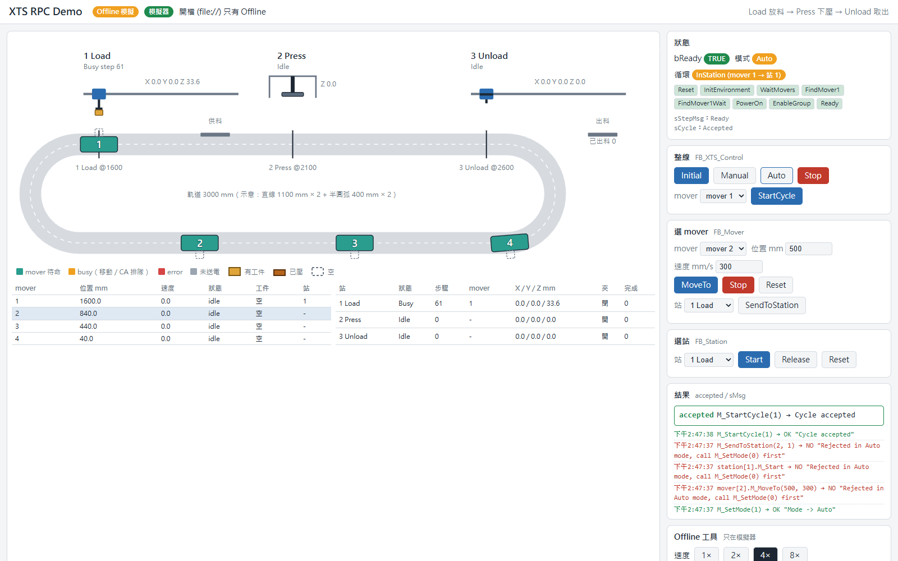
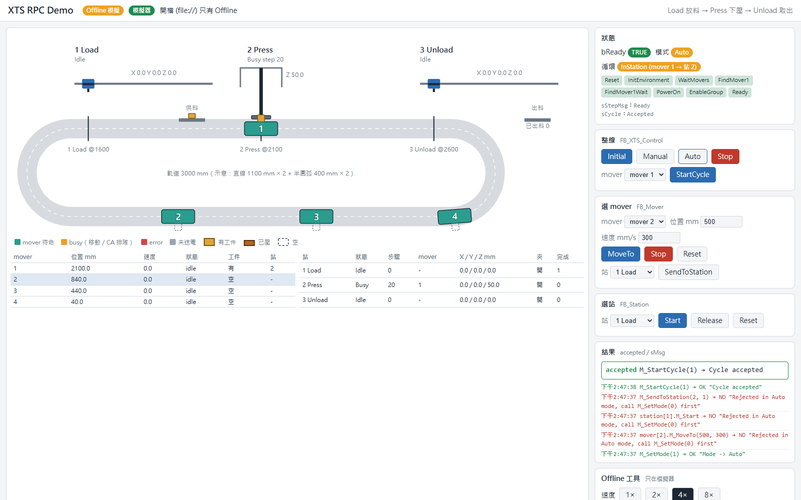

# XTS RPC Demo：C# 用 `TcRpcEnable` method 控制模擬 XTS

在 TwinCAT 3 User Mode Runtime (UmRT) 上跑 XTS 模擬（4 個 mover、3 站），C# console 透過 ADS 的 `InvokeRpcMethod` 呼叫 PLC 上加了 `{attribute 'TcRpcEnable'}` 的 method：初始化 XTS、移動單一 mover、手動操作單站、跑一輪自動循環。

> **狀態（這一版）**：程式寫完、PLC Build 0 error、`dotnet build` 成功。**還沒 Activate、沒在 runtime 上跑過**，所有執行行為都是「初判／待 runtime 驗證」，見[沒測的項目](#沒測的項目)。

## 使用情境

- 上位機（MES、測試程式、網頁）要對 PLC 下「帶參數、要立即回覆能不能做」的命令，例如「mover 2 移到 1500 mm，速度 300」。
- 用寫變數做也可以，但要自己處理「寫參數 → 寫觸發 → 讀回結果」三步的時序；RPC method 一次呼叫就能帶參數、拿到 `BOOL` 與拒絕原因 `sMsg`。
- 本專案示範三件事：
  1. 參數檢查與拒絕原因在 PLC 端做（C# 不用知道軌道長度、速度上限）。
  2. Method 只收命令，動作在 cyclic 程式裡做（原因見[為什麼 method 只設旗標](#為什麼-method-只設旗標)）。
  3. 三層 FB（總控 / mover / 站）各有自己的 RPC method，加上「ready 閘門 + 模式鎖」統一管控誰能下命令。

## 檔案結構

```
plc/
  XtsRpcDemo.sln
  XtsRpcDemo/XtsRpcDemo.tsproj          XTS 模擬設定 (1 XPU、12 module 3000 mm、4 mover、CA group) + 7 支 NC 模擬軸
  XtsRpcDemo/XtsRpcDemoPlc/
    POUs/MAIN                            呼叫 fbXts；REFERENCE 備案路徑 refMover1..4
    POUs/FB_XTS_Control                  總控 (RPC)
    POUs/FB_Mover                        單一 mover (RPC)
    POUs/FB_Station                      站底層 (RPC)
    POUs/FB_StationGantry                XYZ 取放站共用 (EXTENDS FB_Station)
    POUs/FB_StationLoad / FB_StationUnload   EXTENDS FB_StationGantry
    POUs/FB_StationPress                 EXTENDS FB_Station
    POUs/FB_SimAxis                      單支 NC 模擬軸包裝 (MC_Power / MC_MoveAbsolute / MC_Halt)
    POUs/FB_CaGroup                      CA group：加軸、enable、disable
    POUs/F_CheckCmdAllowed               ready 閘門 + 模式鎖，所有命令 method 共用
    DUTs/ GVLs/                          狀態列舉、狀態 STRUCT、常數 (GVL_Param)、錯誤碼 (GVL_ErrorId)
csharp/                                  .NET 8 console，NuGet Beckhoff.TwinCAT.Ads 7.0.389
web/                                     網頁模擬器：ASP.NET Core minimal API (.NET 8) + 純靜態前端，與 csharp/ 共用 RPC client 原始碼
  XtsWeb.csproj Program.cs PlcService.cs   API endpoint、ADS 連線、狀態輪詢 + SSE
  wwwroot/index.html css/ js/              SVG 畫面；sim.js = Offline 模擬器，live.js = Live 後端，app.js = 畫面與按鈕
docs/images/                             截圖
```

XTS 設定來自另一個已在 UmRT 上跑過 CA 繞線的示範專案，從 6 mover 刪成 4 mover（刪掉 Mover 5/6 的 TcCOM 物件、NC 軸與 mapping），XPU 的 `IdDetectionMode` 從 `Standard` 改成 `Mover1`（讓 Find mover 1 真的執行），其他參數不動：模擬模式、軌道 3000 mm、mover 啟動位置 `UseOffsetAndDistance`（offset 40 mm、間距 400 mm、±10 mm 隨機）。

## 架構

```
 C# (XtsRpcClient)
   │  AdsClient.InvokeRpcMethod(symbolPath, methodName, args, out outputs)
   ▼
 ADS ──► PLC port 851
          MAIN.fbXts : FB_XTS_Control ─────────────── 總控 RPC
            │  每 cycle 寫 stPermit (bReady, eMode) 給子 FB
            ├─ aMover[1..4] : FB_Mover ────────────── mover RPC ── MC_Power / MC_MoveAbsoluteCA / MC_HaltCA ── NC Mover Axis 1..4 ── XTS (模擬)
            ├─ fbGroup : FB_CaGroup ──────────────────────────────── CA group (XtsCaGroup)
            ├─ fbLoad   : FB_StationLoad   ─┐                         XYZ：NC Load X / Y / Z     (模擬軸)
            ├─ fbPress  : FB_StationPress  ─┼─ 站 RPC (繼承自 FB_Station)  Z：NC Press Z          (模擬軸)
            └─ fbUnload : FB_StationUnload ─┘                         XYZ：NC Unload X / Y / Z   (模擬軸)
```

站位置（mover 停止點，環上 mm）：Load 1600、Press 2100、Unload 2600（`GVL_Param.cStationPosMm`）。

## 三層 FB 的 RPC method

所有命令 method 回 `BOOL`（TRUE = 已接受，**不是已完成**），最後一個輸出 `sMsg : STRING` 是拒絕原因或 `'Accepted'`。進度用狀態 method 輪詢。

### 總控 `FB_XTS_Control`（C# 路徑 `MAIN.fbXts`）

| Method | 輸入 | 輸出 | 條件 |
|---|---|---|---|
| `M_InitialXTS` | – | `sMsg` | 不在初始化中、沒在自動循環、尚未 ready |
| `M_ReadXTS_Status` | – | `bIsReady, eStep : E_InitStep, sStepMsg, bIsError, nErrId : UDINT, eModeNow : E_XtsMode` | 隨時可讀 |
| `M_GetStatus` | – | `stLine : ST_LineStatus, sCycle` | 隨時可讀；整線快照（4 mover、3 站、XYZ / 下壓軸位置、循環），給之後的網頁模擬器用 |
| `M_SetMode` | `nMode : INT`（0 Manual / 1 Auto） | `sMsg` | 自動循環中拒絕；不受 ready 限制 |
| `M_StartCycle` | `nMover : UINT` | `sMsg` | ready + **Auto**、三站 Idle、mover 沒工件、路徑上沒有別的 mover |
| `M_Stop` | – | `sMsg` | **永遠接受**（不受 ready / 模式限制） |
| `M_MoveTo` | `nMover : UINT, fPosition : LREAL, fVelocity : LREAL` | `sMsg` | ready + Manual；陣列元素路徑不能用時的備案 |
| `M_SendToStation` | `nMover : UINT, nStation : UINT` | `sMsg` | ready + Manual、站號 1..3、站沒被別的 mover 佔用 |
| `M_StartStation` / `M_ReleaseStation` | `nStation : UINT` | `sMsg` | ready + Manual；繼承來的站 RPC 不能用時的備案 |

### 單一 mover `FB_Mover`（C# 路徑 `MAIN.fbXts.aMover[n]`，備案 `MAIN.refMover{n}`）

| Method | 輸入 | 輸出 | 條件 |
|---|---|---|---|
| `M_MoveTo` | `fPosition : LREAL`（mm，0 ≤ p < 3000）, `fVelocity : LREAL`（mm/s，0 < v ≤ 1500） | `sMsg` | ready + Manual、mover 沒 error、已送電、上一個命令已被 PLC 取走 |
| `M_Stop` | – | `sMsg` | 永遠接受（沒送電時回 `'Not powered, nothing to stop'`，仍回 TRUE） |
| `M_Reset` | – | `sMsg` | ready + Manual |
| `M_GetStatus` | – | `fPosition, fVelocity, bBusy, bError, nErrorId, bHasPart, bPressed, bPowered` | 隨時可讀 |

`M_MoveTo` 只往正方向走：目標 = 目前位置 + 環上差距。

### 單站 `FB_Station`（C# 路徑 `MAIN.fbXts.fbLoad` / `fbPress` / `fbUnload`）

| Method | 輸入 | 輸出 | 條件 |
|---|---|---|---|
| `M_Start` | – | `sMsg` | ready + Manual、站 Idle、站上有 mover、工件狀態符合（Load：沒工件；Press：有工件且沒下壓；Unload：有工件） |
| `M_Release` | – | `sMsg` | ready + Manual、站在 Done |
| `M_Reset` | – | `sMsg` | ready + Manual；清站的 Error 回 Idle |
| `M_GetStatus` | – | `nState, nStepNow, bOccupiedNow, nMoverNow, bErrorNow, nErrorIdNow, nDone, fAxisX, fAxisY, fAxisZ` | 隨時可讀 |

工件檢查用的是子類別覆寫的 `M_CheckStart`（`FB_StationLoad` / `FB_StationPress` / `FB_StationUnload` 各一份），站動作步驟是子類別覆寫的 `M_Sequence`。

### 為什麼 RPC 放三層、總控又留 `M_MoveTo` / `M_SendToStation`

- 三層都有 RPC：C# 可以直接對「那台 mover」「那一站」下命令，PLC 端的檢查（參數範圍、站狀態、工件狀態）就寫在該物件裡，總控不用知道站內細節。
- 總控保留 `M_MoveTo(nMover, ...)`、`M_SendToStation`、`M_StartStation`、`M_ReleaseStation`：
  1. `M_SendToStation` 要同時看「站有沒有被別的 mover 佔用」，這個資訊只有總控有。
  2. **備案路徑**：陣列元素（`aMover[2]`）與繼承來的 method（`fbPress` 上的 `M_Start` 定義在 `FB_Station`）能不能直接 `InvokeRpcMethod` 還沒在 runtime 驗過，總控層的 method 路徑一定是 `MAIN.fbXts`，不受影響。

## ready 閘門與模式鎖

**規則**

| 命令 | 未 ready | ready + Manual | ready + Auto |
|---|---|---|---|
| 讀狀態（`M_GetStatus`、`M_ReadXTS_Status`） | 收 | 收 | 收 |
| `M_Stop`（總控、mover） | **收** | 收 | 收 |
| `M_SetMode` | 收 | 收 | 收（自動循環中拒絕） |
| `M_InitialXTS` | 收 | 拒（已 ready） | 拒（已 ready） |
| mover / 站的直接命令、總控 `M_MoveTo`、`M_SendToStation` | 拒：`XTS not ready, call M_InitialXTS first` | 收 | 拒：`Rejected in Auto mode, call M_SetMode(0) first` |
| `M_StartCycle` | 拒 | 拒：`Needs Auto mode, call M_SetMode(1) first` | 收 |

**為什麼要模式鎖**：自動循環在跑時，如果 C# 同時對同一台 mover 下 `M_MoveTo`，兩個來源會搶同一個 MC FB 的命令，mover 走到哪裡取決於誰最後寫；Auto 時把直接命令擋掉，自動循環就是唯一的命令來源。

**為什麼要 ready 閘門**：初始化沒完成時 mover 沒送電、沒加進 CA group，下移動命令只會得到 MC 錯誤；先在 PLC 擋掉並回原因，C# 看得懂。

**Stop 永遠收**：停止是安全動作，不能因為「還沒 ready」或「在 Auto」被擋。沒送電時 Stop 視為 no-op，回 TRUE 並在 `sMsg` 說明。

**檢查只寫在一個地方**：`F_CheckCmdAllowed(stPermit, bNeedManual, bNeedAuto, sMsg =>)`。總控每個 cycle 算出 `stPermit`（`bReady`、`eMode`），在呼叫子 FB 時當 `VAR_INPUT` 傳進去；子 FB 的 method 用自己的 `stPermit` 呼叫同一個函式。

- 選「總控每 cycle 寫給子 FB」而不是「子 FB 拿 REFERENCE 指回總控」：子 FB 不依賴總控的型別，也沒有 reference 失效（Online Change）的問題；RPC method 是在 PLC cycle 之後才執行（見下節），讀到的就是本 cycle 寫進去的值。

**掉出 ready**：Ready 狀態下任何 mover error、mover 失電、CA group 不是 ready、站上軸 error，都會讓 `eInitStep` 進 `Error`、`bReady` = FALSE，所有命令再被擋，直到重新 `M_InitialXTS` 成功（`M_InitialXTS` 會先做 MC_Reset / group reset）。

## 為什麼 method 只設旗標

每個命令 method 只做三件事：檢查參數與狀態 → 寫入請求變數（`bReqMove`、`fReqPositionMm` …，旗標最後寫）→ 回 `BOOL` + `sMsg`。真正的 MC 呼叫在 FB body（cyclic）裡。

1. **執行時機**：Beckhoff 的說明是 RPC method「在 PLC 執行之後被呼叫，使用 cycle 剩下的時間」，method 需要的時間超過剩餘時間就會 real-time overrun（[PLC method call 範例](https://infosys.beckhoff.com/content/1033/tc3_adssamples_net/1046349195.html)）。所以 method 不能等、不能跑迴圈等條件成立，要快進快出。
2. **MC FB 要每 cycle 呼叫**：`MC_MoveAbsoluteCA`、`MC_Power` 這類 FB 靠每個 cycle 被呼叫才會推進狀態（Execute 上升沿、Busy / Done）。只在 method 裡呼叫一次，下一個 cycle 就沒人呼叫它了。
3. **併發**：兩個 C#（或 C# + HMI）可能幾乎同時呼叫同一個 method。method 內先檢查 `bReqMove` 還沒被取走就拒絕（`'Previous command not yet taken by PLC, retry'`），body 每個 cycle 取走一次，命令不會互相覆蓋。
4. **同一個命令兩個來源**：自動循環（cyclic 程式內部）與 RPC 都經過同一個內部 method（例如 `FB_Mover.M_RequestMove`），參數檢查只有一份。

> 注意：題目原本的假設是「method 在 ADS 執行緒、跟 PLC task 非同步」。InfoSys 上面那句話的意思是 method 在 PLC 執行完之後於同一個 real-time 情境裡被呼叫。本專案的做法兩種情況都安全；實際在哪個執行緒、跟 task 的先後，**待 runtime 驗證**。

PLC 片段（`FB_Mover`）：

```iecst
{attribute 'TcRpcEnable'}
METHOD PUBLIC M_MoveTo : BOOL
VAR_INPUT
    fPosition : LREAL;      // 目標環上位置 (mm), 0 <= p < cTrackLengthMm
    fVelocity : LREAL;      // 速度 (mm/s), 0 < v <= cMaxVelocityMmS
END_VAR
VAR_OUTPUT
    sMsg : STRING;          // 拒絕原因或 'Accepted'
END_VAR

IF NOT F_CheckCmdAllowed(stPermit := stPermit, bNeedManual := TRUE, bNeedAuto := FALSE, sMsg => sMsg) THEN
    M_MoveTo := FALSE;
    RETURN;
END_IF
M_MoveTo := M_RequestMove(fPosition := fPosition, fVelocity := fVelocity, sMsg => sMsg);
```

```iecst
// FB_Mover body：命令只在這裡取走
IF bReqStop THEN
    bReqStop := FALSE;
    bReqMove := FALSE;
    eMoveState := E_MoveState.StartHalt;
ELSIF bReqMove THEN
    bReqMove := FALSE;
    fTargetAbsMm := stAxis.NcToPlc.ActPos + F_RingPosition(...);
    eMoveState := E_MoveState.StartMove;   // 先讓 Execute = FALSE 一個 cycle
END_IF
fbMove(Axis := stAxis, Execute := (eMoveState = E_MoveState.Moving), Position := fTargetAbsMm, ...);
```

## 初始化：`M_InitialXTS`

```
Idle ─M_InitialXTS─► Reset ─► InitEnvironment ─► WaitMovers ─► FindMover1 ─┬─► PowerOn ─► EnableGroup ─► Ready
                    (MC_Reset,  (Tc3_XTS_Utility   (偵測到 4 台   (Mover1 模式:   │  (MC_Power     (加進 CA group
                     斷電 0.5 s) 環境 Init)          且位置有效)    觸發 detection) │   mover+站軸)   並 enable)
                                                                  └─► FindMover1Wait ─┘
任何一步失敗或逾時 (5 分鐘 PLC 時間) ─► Error，sInitMsg = '<步驟>: <原因>'
Ready 後掉出可控 ─► Error，需重新 M_InitialXTS
```

- 順序照需求：**Find mover 1 → 送電 → 啟用 CA group**。
- **Find mover 1 會真的執行**：XPU 的 `IdDetectionMode` 設成 `Mover1`（`plc/XtsRpcDemo/XtsRpcDemo.tsproj`，XTS ProcessingUnit 1 的 `<Value><Name>IdDetectionMode</Name>`）。程式確認模式是 `Mover1` 後呼叫 `TriggerMoverIdDetection()`，等 `GetIsMoverIdDetectionValid()`（失敗看 `GetHasMoverIdDetectionError()`），`sInitMsg` 依序顯示 `FindMover1: Mover ID detection triggered, waiting for result` → `FindMover1 done (Mover ID detection valid), PowerOn`。做法照 InfoSys [PLC variant I (trigger via XtsUtility)](https://infosys.beckhoff.com/content/1033/xts_software/10484562315.html)：前置條件是「所有 mover 位置有效」與「XPU 的模式是 Mover1」。
- **為什麼先 detection 再送電**：XTS 驅動的事件清單（tsproj 內的 TMC 描述）有 `9016 AxisEnabledBeforeMoverIdDetectionError`：「The mover {0} gets an enable command before Mover 1 Detection is processed」。也就是 mover 在 detection 完成前被 enable 會報錯，所以順序是 Find mover 1 → MC_Power → CA group enable。
- **防呆**：若 XPU 被改回 `Standard`，程式不做 detection、直接進 PowerOn，`sInitMsg` 寫 `FindMover1 skipped: XPU IdDetectionMode is not Mover1, PowerOn`，mover 編號照 XTS 設定順序（`MoverSortOrder = Descending`）。
- **模擬模式下 Mover 1 detection 能不能完成：初判可以（XPU 的 `MoverIdStartUpSimulationMode` 會模擬 mover ID），待 runtime 驗證**；之前同一套模擬設定都用 `Standard`，沒跑過 detection。
- `M_ReadXTS_Status` 的 `eStep`（`E_InitStep` 值）與 `sStepMsg` 看得到目前步驟與失敗原因。
- 初始化完成前，`M_StartCycle` 與所有 mover / 站命令都被 `F_CheckCmdAllowed` 擋下。

## 三站流程

| 站 | 動作 | 軸（NC 模擬軸） | mover 工件狀態 |
|---|---|---|---|
| 1 Load | XYZ 從取料點夾工件放到 mover 上 | Load X / Y / Z | 完成後 `bHasPart` = TRUE |
| 2 Press | 下壓 → 保壓 1 s → 上升 | Press Z | 完成後 `bPressed` = TRUE |
| 3 Unload | XYZ 從 mover 夾走工件放到出料點 | Unload X / Y / Z | 完成後兩者清掉 |

Load 與 Unload 各有一組 XYZ（共 7 支模擬軸，需求原本寫 XYZ 3 支 + 下壓 1 支）：一組 XYZ 同時服務相距 1000 mm 的兩站不合實際，改成兩組，共用 `FB_StationGantry`。

**站狀態機（`FB_Station`）**

```
Idle ──M_Start / 自動循環──► Busy ──M_Sequence 完成──► Done ──M_Release──► Idle
                              │  └─ 步驟逾時 2 分鐘 / 軸 error ──► Error ──M_Reset──► Idle
                              └─ M_Stop ──► 停軸，回 Idle
```

**XYZ 取放步驟（`FB_StationGantry.M_Sequence`，Load / Unload 只差取放點）**

```
10 XY 到取料點 (Z 上) → 20 Z 下 → 30 夾 (0.3 s) → 40 Z 上 → 50 XY 到放料點 → 60 Z 下 → 70 放 (0.3 s) → 80 Z 上 → 完成
Load：取料點 = 供料 (300, 150)，放料點 = mover 上方 (0, 0)
Unload：取料點 = mover 上方 (0, 0)，放料點 = 出料 (300, -150)
```

**下壓步驟（`FB_StationPress.M_Sequence`）**

```
10 Z 下到 50 mm → 20 保壓 1 s → 30 Z 回 0 → 完成
```

奇數步（11、21…）才給軸 `Execute = TRUE`，偶數步設目標並讓 `Execute = FALSE`，確保每次移動都有上升沿。

**自動循環（`M_StartCycle(nMover)`，總控）**

```
Idle/Done ─M_StartCycle─► ToStation(Load) ─到站─► InStation(Load) ─Done─► 放行
          ─► ToStation(Press) ─► InStation(Press) ─► ToStation(Unload) ─► InStation(Unload) ─► Done
任何站 Error / 掉出 ready ─► Error；M_Stop ─► Stopped
```

`aStationDoneMs[1..3]` 記錄每站完成的 PLC 時間（從 `M_StartCycle` 起算，ms）。

**CA 與路徑**：mover 都裝在 CA group，前面有車就會排在後面等（`Busy` 一直 TRUE）。`M_StartCycle` 會檢查「這台 mover 往前到 Unload + 110 mm 之間沒有其他 mover」，有就拒絕並說是哪一台。C# 示範程式會自動挑路徑淨空的那台，手動示範完把 mover 停到 2900 mm 讓路。

## C# 用法

```csharp
using var client = new AdsClient();
client.Connect(AmsNetId.Local, 851);   // 不寫死 AmsNetId；遠端用 --netid

// 對單一 mover：輸入參數照 PLC 型別給 (LREAL = double, UINT = ushort)
object? ok = client.InvokeRpcMethod("MAIN.fbXts.aMover[2]", "M_MoveTo",
    new object[] { 1500.0, 300.0 }, out object[]? outs);
Console.WriteLine($"{ok} {outs![0]}");   // outs[0] = sMsg

// 對總控
client.InvokeRpcMethod("MAIN.fbXts", "M_StartCycle", new object[] { (ushort)2 }, out outs);

// 對單站
client.InvokeRpcMethod("MAIN.fbXts.fbPress", "M_Start", Array.Empty<object>(), out outs);
```

- 用的是 `InvokeRpcMethod(symbolPath, methodName, inParameters, out outParameters)`：型別由 PLC 端的 RPC 描述決定。這個多載對 STRUCT 輸出會退回 `byte[]`（[InfoSys](https://infosys.beckhoff.com/content/1033/tc3_ads.net/21455449355.html)：「Complex types will fall back to byte[] arrays」），所以 `M_GetStatus` 的 `ST_LineStatus` 在 C# 端用 `BinaryReader` 依 Pack = 1 的偏移量解析（`csharp/XtsRpc.cs` 的 `LineStatus.Parse`，總長 267 bytes，偏移量照 Build 產生的 TMC）。
- 想要強型別，可改用帶 `AnyTypeSpecifier` 的多載（[InfoSys](https://infosys.beckhoff.com/content/1033/tc3_ads.net/21454374027.html)）；這版沒用。

### C# 三種路徑

| 對象 | 主路徑 | 備案（命令列切換，不用改程式） |
|---|---|---|
| 總控 | `MAIN.fbXts` | – |
| 單一 mover | `MAIN.fbXts.aMover[{n}]` | `--mover-path "MAIN.refMover{0}"`（MAIN 裡的 `REFERENCE TO FB_Mover`）；或 `--mover-via-control`（改呼叫總控 `M_MoveTo(nMover, ...)`） |
| 單站 | `MAIN.fbXts.fbLoad` / `fbPress` / `fbUnload` | `--station-via-control`（改呼叫總控 `M_StartStation` / `M_ReleaseStation`） |

**陣列元素路徑可行性：初判可行，待 runtime 驗證。** 依據：

1. Build 產生的 TMC 裡，`FB_XTS_Control` 的子項 `aMover` 型別就是 `FB_Mover`（陣列），而 `FB_Mover` 型別上的 `M_MoveTo`、`M_Stop`、`M_Reset`、`M_GetStatus` 都標了 `RpcEnable="plc"`。RPC 資訊掛在型別上，陣列元素是同一個型別。
2. InfoSys 的 PLC method call 範例是對 symbol 取 handle（`<instance>#<method>`）再呼叫；ADS symbol 路徑本來就支援陣列索引。
3. InfoSys 上找不到「陣列元素可不可以呼叫 RPC method」的明確說法。

**繼承來的 method**：TMC 裡 `FB_StationLoad` / `FB_StationPress` / `FB_StationUnload` 自己的型別描述沒有列出 RPC method，RPC method 只出現在 `FB_Station`（子類別以 `ExtendsType` 指向父類別）。ADS 解析 `MAIN.fbXts.fbPress#M_Start` 時會不會沿繼承鏈找：**待 runtime 驗證**，不行就用 `--station-via-control`。

## 怎麼跑

需要：TwinCAT 3.1.4026（XAE + UmRT）、TF5850 XTS、TF5400 Advanced Motion Pack（CA）的授權（試用授權即可）、.NET 8 SDK。

1. 用 TwinCAT XAE Shell 開 `plc/XtsRpcDemo.sln`，Target 選本機 UmRT，Platform `TwinCAT OS (x64)`。
2. Build → Activate Configuration → PLC Login → Start。
3. 跑 C#：

   ```
   dotnet run --project csharp
   dotnet run --project csharp -- --netid <AmsNetId> --port 851
   dotnet run --project csharp -- --mover-path "MAIN.refMover{0}"
   ```

C# 示範流程：

1. ready 前對 mover 2 下 `M_MoveTo` → 被拒，印出 `sMsg`
2. `M_InitialXTS` → 每 0.5 s 輪詢 `M_ReadXTS_Status`，印出步驟，直到 ready（逾時 900 s 印原因結束）
3. `M_SetMode(0)` Manual
4. 單一 mover：`M_GetStatus` → 不合法參數兩次（位置 5000、速度 -1）被拒 → `M_MoveTo` 往前 150 mm → 等停下 → `M_Stop`
5. 單站：`M_SendToStation` 送到 Load → 站 `M_Start` → 等 Done → `M_Release`，Press、Unload 同樣，印出 mover 工件狀態；最後停到 2900 mm
6. `M_SetMode(1)` Auto，示範 Auto 下直接對 mover 的命令被拒
7. `M_StartCycle` 跑一輪，印出每站完成時的牆鐘秒數與 PLC 秒數
8. 總控 `M_Stop`

## 網頁模擬器（`web/`）

一頁網頁：SVG 畫 XTS 軌道（直線段 + 兩端半圓弧）、3 個站（Load / Unload 的 XYZ 機械手、Press 的下壓頭）與 4 台 mover；控制區分三塊（整線 / 選 mover / 選站），顯示 `bReady`、模式、初始化步驟與 `sStepMsg`，每個按鈕的 `accepted` 與 `sMsg` 顯示在「結果」。

- mover 顏色：待命（青）、busy（橘，含 CA 排隊）、error（紅 + 外框）、未送電（灰）；編號標在 mover 上，點 mover 可選取。
- 工件三種樣子：**有**（橘色方塊）、**已壓**（深色扁方塊）、**空**（虛線框）。Load 站夾住時工件在夾爪上，放開後落到 mover；Unload 夾走後落到出料盤。
- 命令按鈕不會因為 ready / 模式而反灰，故意讓你按下去看 PLC 回的拒絕原因（`XTS not ready, call M_InitialXTS first`、`Rejected in Auto mode, call M_SetMode(0) first` …）。

### 怎麼開

| 模式 | 怎麼開 | 說明 |
|---|---|---|
| **Offline** | 直接用瀏覽器開 `web/wwwroot/index.html`（`file://`），或 server 起來後網址加 `?mode=offline` | 不接 PLC，不需要 .NET；JS 自己模擬。畫面與按鈕跟 Live 一樣，多一塊「Offline 工具」（1×~8× 加速、對所選 mover 製造 error、下次 Initial 失敗、重設模擬） |
| **Live** | `dotnet run --project web`，開 `http://localhost:5080` | server 預設只綁 localhost（這頁能對 PLC 下命令）。Live 是 server 提供時的預設，右上角連結可切到 Offline |

Live 的命令列參數沿用 console：`--netid`、`--port`、`--control-path`、`--mover-path`、`--station-path`、`--mover-via-control`、`--station-via-control`、`--poll-ms`（網頁預設 250 ms）。另有 `--no-detail-status`（關掉 mover / 站 `M_GetStatus` 輪詢）；`--urls http://localhost:5081` 之類交給 ASP.NET Core。備案路徑開關與 console 完全相同：

```
dotnet run --project web -- --mover-path "MAIN.refMover{0}" --station-via-control
```

**Live 的資料流**：背景工作每 `--poll-ms` 呼叫一次 `M_ReadXTS_Status` 與總控 `M_GetStatus`（`ST_LineStatus` 內含 4 mover、3 站、XYZ / 下壓軸位置、循環），每 4 次再對每台 mover、每一站呼叫各自的 `M_GetStatus`（走陣列元素 / 繼承 method 路徑；失敗訊息放在狀態 JSON 的 `detailWarnings`，網頁頂端會顯示）。結果合成同一份 JSON，用 SSE（`/api/events`）推給所有開著的網頁。命令與輪詢共用一條 ADS 連線，一次一個呼叫。

**與 console 共用 RPC client**：`web/XtsWeb.csproj` 用 `<Compile Include>` 直接連結 `csharp/XtsRpc.cs`、`csharp/Options.cs`（`XtsRpc`、`LineStatus`、`Options`），不複製。console 只多了兩個 wrapper（`MoverReset`、`StationReset`），既有行為不變。

### API endpoint

所有命令 endpoint 回 `{ "accepted": bool, "sMsg": string }`（`accepted` = PLC method 的 BOOL 回傳值；ADS 連不上或 symbol 找不到回 HTTP 502，`accepted = false`，`sMsg` 是錯誤原因）。

| Method + 路徑 | Body | 呼叫的 PLC method |
|---|---|---|
| `GET /api/events` | – | SSE，每次輪詢結果一筆 JSON |
| `GET /api/status` | – | 最近一次輪詢結果（同 SSE 的 JSON） |
| `GET /api/info` | – | 目前的路徑設定（`controlPath`、`moverPath` …） |
| `POST /api/initial` | – | `M_InitialXTS` |
| `POST /api/mode` | `{ "mode": 0 或 1 }` | `M_SetMode` |
| `POST /api/cycle/start` | `{ "mover": n }` | `M_StartCycle` |
| `POST /api/stop` | – | `M_Stop`（總控） |
| `POST /api/mover/{n}/move-to` | `{ "position": mm, "velocity": mm/s }` | `aMover[n].M_MoveTo`（備案：總控 `M_MoveTo`） |
| `POST /api/mover/{n}/stop` | – | `aMover[n].M_Stop` |
| `POST /api/mover/{n}/reset` | – | `aMover[n].M_Reset` |
| `POST /api/mover/{n}/send-to-station` | `{ "station": s }` | 總控 `M_SendToStation` |
| `POST /api/station/{n}/start` | – | `fbLoad/fbPress/fbUnload.M_Start`（備案：總控 `M_StartStation`） |
| `POST /api/station/{n}/release` | – | 站 `M_Release`（備案：總控 `M_ReleaseStation`） |
| `POST /api/station/{n}/reset` | – | 站 `M_Reset` |

### Offline 模擬跟 PLC 實際行為的差異

Offline 在 JS 重現的部分：Initial 步驟（Reset → InitEnvironment → WaitMovers → **FindMover1（真的執行）** → FindMover1Wait → PowerOn → EnableGroup → Ready，`sInitMsg` 字串照 PLC）、ready 閘門、Auto/Manual 模式鎖、所有命令的拒絕字串（`F_CheckCmdAllowed`、`M_RequestMove`、各站 `M_CheckStart` 同一份文字）、mover 梯形加減速（2000 mm/s²）、CA 不追撞（與前車保持 110 mm）、三站狀態機與 XYZ / 下壓步驟、工件三態、自動循環、掉出 ready。站位置（1600 / 2100 / 2600）、軌道長 3000、速度與時間參數取自 `GVL_Param`。

**差異（Offline 不等於 PLC）：**

| 項目 | Offline | PLC / Live |
|---|---|---|
| 時間 | 瀏覽器真實時間，可 1×~8× 加速；初始化各步驟的耗時（InitEnvironment 1.5 s、detection 2 s …）是示意值 | 取決於 XTS 與 runtime；UmRT 比牆鐘慢約 4.25 倍 |
| mover 運動 | 梯形速度曲線，沒有 jerk；CA 簡化成「離前車 110 mm 就限速」 | `MC_MoveAbsoluteCA`，jerk 20000 mm/s³，CA 由 XTS 決定 |
| mover 起點與編號 | 固定 1240 / 840 / 440 / 40 mm（offset 40、間距 400，沒有 ±10 mm 隨機；編號順序是依 `MoverSortOrder = Descending` 的推測） | 隨機 ±10 mm；編號由 XTS 與 Mover ID detection 決定，**沒確認** |
| Find mover 1 | 只模擬步驟、字串與耗時；不會重新編號 | 真的觸發 `TriggerMoverIdDetection()` |
| 軌道畫法 | 示意：直線 1100 mm × 2 + 半圓弧 400 mm × 2，順時針；環上位置 0 的實體位置與繞行方向沒確認 | 環上位置由 NC 軸 `ActPos` 換算 |
| 命令被「取走」 | 下一個模擬 tick 取走（約 20 ms） | 下一個 PLC cycle；`Previous command not yet taken by PLC, retry` 在 Offline 幾乎不會出現 |
| 站軸 | 簡單梯形（200 mm/s、1000 mm/s²），不會 error | NC 模擬軸（預設參數沒調）；軸 error 與站步驟逾時會讓站進 Error、整線掉出 ready，Offline 不會發生 |
| error | 只能用「製造 error」按鈕注入 mover error（假碼 `16#4550`；掉出 ready 的 `16#E310` 是 PLC 的碼） | 來自 NC / MC |
| `LREAL_TO_STRING` | 範圍錯誤的 `sMsg` 寫成 `... < 3000.0`（推測 TwinCAT 的輸出格式） | 以 PLC 實際輸出為準，**沒驗證** |

### Live 驗證要補跑的步驟（UmRT）

本階段沒碰 runtime，Live 只 build 過。到 UmRT 驗證時照下面順序（需要先 Activate、PLC Run）：

1. `dotnet run --project web`，開 `http://localhost:5080`，右上角應顯示「PLC 已連線」；網頁頂端沒有 `detailWarnings`。
2. **陣列元素 / 繼承 method 路徑**：若頂端出現 `mover[n].M_GetStatus: ...` 或 `station[n].M_GetStatus: ...`，該路徑不能直接 `InvokeRpcMethod`，改用 `--mover-path "MAIN.refMover{0}"`、`--mover-via-control`、`--station-via-control` 重跑，並把結論補進本文「C# 三種路徑」。
3. **ready 前**：按 MoveTo / SendToStation / 站 Start / StartCycle → 結果欄看到 `XTS not ready, call M_InitialXTS first`；按 Stop 與切模式要被接受。
4. **Initial**：步驟條依序走完到 Ready（錄影可從這裡開始拍）；記下 FindMover1 在模擬模式下有沒有過。
5. **Manual**：mover MoveTo / Stop / SendToStation、站 Start / Release，網頁與 XTS Viewer 的 mover 同時動。
6. **Auto**：切 Auto 後手動按鈕被拒（`Rejected in Auto mode, ...`）；選路徑淨空的 mover 按 StartCycle，拍一輪完整流程：放料 → 下壓 → 取出。
7. 製造 error 再被擋（只在安全時做）：確認 `bReady` 掉成 FALSE、`sStepMsg` 顯示 `Ready: ...`，命令被擋。
8. 錄影只放本機，不進 repo。

### Offline 截圖

跑完整一輪的截圖（`docs/images/`；用 Edge headless 對 `file://` 開檔、按畫面按鈕產生）：

| 檔案 | 內容 |
|---|---|
| `web-offline-1-not-ready.png` | ready 前 MoveTo / StartCycle / 站 Start 全被拒 |
| `web-offline-2-initial-findmover1.png` | Initial 進行中，停在 FindMover1Wait |
| `web-offline-3-ready.png` | Initial 完成，`bReady` = TRUE |
| `web-offline-4-auto-rejects-manual.png` | Auto 時手動 MoveTo / 站 Start / SendToStation 被拒 |
| `web-offline-5-load-place.png` | StartCycle：Load 站 XYZ 放料 |
| `web-offline-6-press-down.png` | Press 站下壓保壓 |
| `web-offline-7-unload-pick.png` | Unload 站夾走已壓工件 |
| `web-offline-8-cycle-done.png` | 一輪完成，出料 1 件 |
| `web-offline-9-error-blocks.png` | 製造 mover error 後掉出 ready，命令被擋 |
| `web-offline-10-init-fail.png` | 「下次 Initial 失敗」：步驟條標紅，顯示失敗原因 |




## 注意事項

- **UmRT 時間比實際慢約 4.25 倍**：前一次在同一台電腦的 UmRT 實測，PLC 量到的經過時間 134 s 對應牆鐘約 570 s；PLC task 實際速率只有設定的約 1/17。PLC 裡的 TIME、計時器、`aStationDoneMs`、mover 速度在錄影裡看起來都會變慢，**錄影速度與 PLC 回報時間都不代表實機**。逾時值（初始化每步 5 分鐘、站每步 2 分鐘）因此放寬。
- **參數型別**：本專案的 RPC 參數只用 `BOOL`、`INT`、`UINT`、`UDINT`、`LREAL`、`STRING(80)`、`STRUCT`（輸出）。沒用 `POINTER`、`REFERENCE`、`INTERFACE`：位址或介面指標對另一台電腦上的 C# 沒有意義。InfoSys 的 [TcRpcEnable](https://infosys.beckhoff.com/content/1033/tc3_plc_intro/7145472907.html) 與 [PLC method call](https://infosys.beckhoff.com/content/1033/tc3_adssamples_net/1046349195.html) 頁面沒有列出不支援型別清單；後者提到 `POINTER` 參數可以用 `{attribute 'TcRpcLengthIs' := 'len'}` 指定陣列長度。哪些型別真的不支援：沒測。
- **method 內不能設中斷點**：InfoSys 說 method 內不支援 breakpoint，可能產生 exception（[PLC method call](https://infosys.beckhoff.com/content/1033/tc3_adssamples_net/1046349195.html)）。
- **`sMsg` 用英文**：PLC 的 `STRING` 是單位元組字元，中文會變亂碼；要中文得改 `WSTRING`。
- **Build 有 1 個 warning**：`C0357 ... P_XtsEnvironmentConfiguration ... obsolete`，來自 `Tc3_XTS_Utility` 的舊 API；原示範專案就有，照用以保留已驗證過的初始化方式。
- `M_Stop` 中止站動作時夾爪狀態保留，工件可能還在夾爪上；本示範不處理復原。
- `M_MoveTo` 只往正方向走；mover 停在目標「稍微過頭」時，再對同一點下命令會繞一整圈。

## 截圖

- PLC Build 0 error：
- 下一階段補：`docs/images/xts-viewer-cycle.png`（XTS Viewer 跑自動循環）、`docs/images/csharp-console.png`（C# 執行輸出）

## 沒測的項目

| 項目 | 原因 |
|---|---|
| Activate、PLC Run、任何 RPC 實際呼叫 | 這一階段只做到 Build，runtime 驗證交給下一階段 |
| 陣列元素（`aMover[n]`）與繼承 method（`fbPress.M_Start`）能否 `InvokeRpcMethod` | 同上；已準備 REFERENCE 與總控層備案 |
| STRING 輸出參數、enum 輸出參數、STRUCT→byte[] 的實際 marshal 結果 | 同上 |
| method 實際執行的執行緒與時機 | 同上；只有 InfoSys 文字依據 |
| Find mover 1（Mover ID detection）在模擬模式下能否完成 | 已設 `IdDetectionMode = Mover1`，只 Build 過；之前的模擬設定都用 `Standard`，沒跑過 detection |
| 4 mover 版本的 XTS 設定能否 Activate | 從已驗證的 6 mover 設定刪掉 2 台，只 Build 過 |
| 7 支 NC 模擬軸的參數（速度上限、加速度） | 用 TwinCAT 預設值，沒調 |
| C# `dotnet run` | 沒有 runtime 可連，只做 `dotnet build` |
| 網頁 Live 模式實際連線（SSE 狀態、命令 endpoint、`M_GetStatus` 輪詢路徑） | 本階段不碰 runtime，只 `dotnet build web`，並用不存在的 AmsNetId 確認連不上時回 `connected:false` 與 HTTP 502；待 UmRT 驗證 |
| 網頁 Offline 與 PLC 行為的一致程度 | Offline 只依 POU 原始碼重現，沒對照 runtime 輸出；差異見「Offline 模擬跟 PLC 實際行為的差異」 |

## 參考資料（Beckhoff InfoSys）

- [Attribute 'TcRpcEnable'](https://infosys.beckhoff.com/content/1033/tc3_plc_intro/7145472907.html)：放在 method 宣告上一行，啟用 RPC
- [PLC method call（.NET 範例）](https://infosys.beckhoff.com/content/1033/tc3_adssamples_net/1046349195.html)：執行時機、CPU 時間、breakpoint、`TcRpcLengthIs`
- [AdsConnection.InvokeRpcMethod（AnyTypeSpecifier 多載）](https://infosys.beckhoff.com/content/1033/tc3_ads.net/21454374027.html)
- [IRpcCallableInstance.InvokeRpcMethod(String, Object[], Object[])](https://infosys.beckhoff.com/content/1033/tc3_ads.net/21455449355.html)：只正確 marshal 基本型別，複雜型別回 `byte[]`
- [XTS：PLC variant I (trigger via XtsUtility)](https://infosys.beckhoff.com/content/1033/xts_software/10484562315.html)：從 PLC 觸發 Mover ID detection

---

## English summary

A TwinCAT 3 demo that runs a simulated XTS (4 movers, 3 stations: Load / Press / Unload) on the User Mode Runtime and controls it from a .NET 8 console through `AdsClient.InvokeRpcMethod` on PLC methods marked `{attribute 'TcRpcEnable'}`.

- **Three FB layers, each with RPC methods**: `FB_XTS_Control` (`MAIN.fbXts`: `M_InitialXTS`, `M_ReadXTS_Status`, `M_GetStatus`, `M_SetMode`, `M_StartCycle`, `M_Stop`, plus fallback `M_MoveTo` / `M_SendToStation` / `M_StartStation` / `M_ReleaseStation`), `FB_Mover` (`MAIN.fbXts.aMover[n]`: `M_MoveTo`, `M_Stop`, `M_Reset`, `M_GetStatus`) and `FB_Station` (`MAIN.fbXts.fbLoad|fbPress|fbUnload`: `M_Start`, `M_Release`, `M_Reset`, `M_GetStatus`).
- **Methods only validate and set request flags**; MC function blocks run in the cyclic body. Beckhoff documents that RPC methods are called after the PLC cycle using the remaining cycle time, so they must return quickly.
- **Ready gate + Auto/Manual lock** in one function (`F_CheckCmdAllowed`); `M_Stop` is always accepted.
- **Init sequence**: reset → XTS environment init → wait for movers → Find mover 1 (`IdDetectionMode = Mover1`; the XTS event 9016 "AxisEnabledBeforeMoverIdDetectionError" requires detection before enabling the movers) → power on → enable the CA group.
- **Status**: PLC builds with 0 errors (1 inherited obsolete warning), `dotnet build` succeeds. Nothing has been activated or run yet; RPC calls on array elements and inherited methods are unverified, and fallback paths are selectable from the command line.
- UmRT time ran about 4.25x slower than wall-clock time on the test PC, so recorded speeds and PLC timings do not represent real hardware.
- **Web simulator (`web/`)**: one static page (SVG track, stations, movers, workpiece states) with a control panel for the line, a mover and a station. *Offline* mode (open `web/wwwroot/index.html`, or `?mode=offline`) re-implements the PLC behaviour in JS, including the init steps, ready gate, Auto/Manual lock and the same rejection strings. *Live* mode (`dotnet run --project web`) is an ASP.NET Core minimal API that reuses the console's RPC client classes and pushes `M_ReadXTS_Status` / `M_GetStatus` to the page over SSE. Only `dotnet build` and the Offline mode were tested; Live against a runtime is untested.
